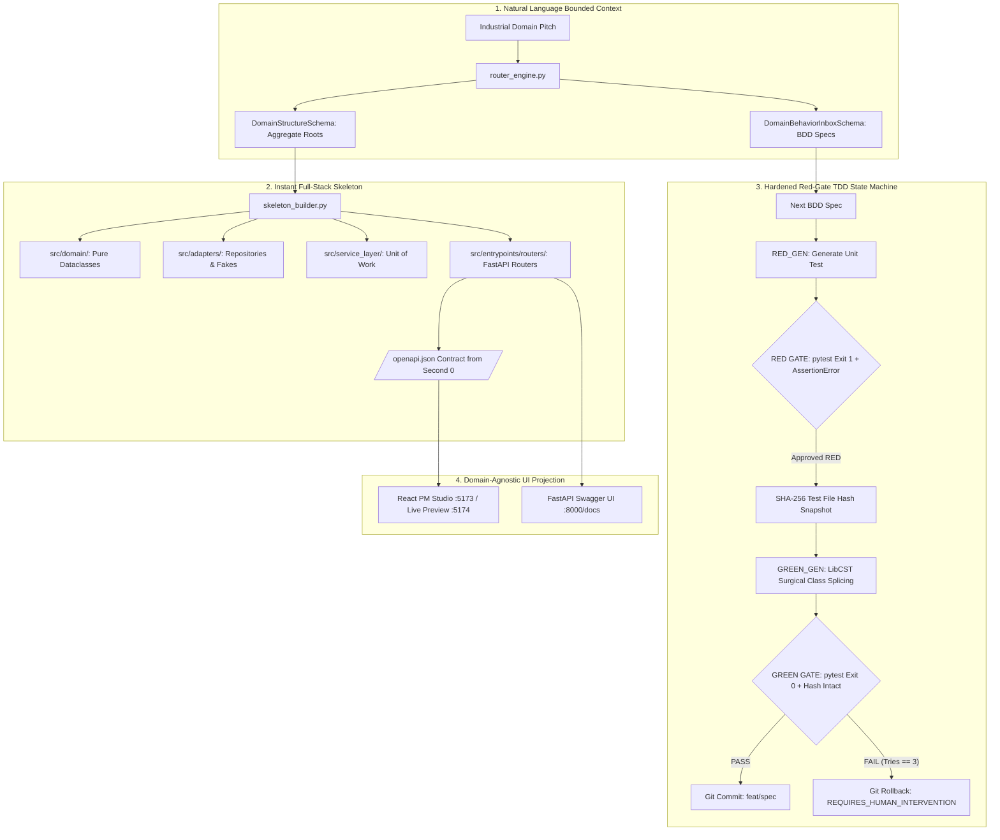

<div align="center">

# 🛡️ Provable

**Deterministic Domain-Driven Design (DDD) & Test-Driven Development (TDD) AppGen Engine**

*Enterprise-grade, specification-driven application generator transforming industrial business requirements into verified DDD Python backends and schema-projected interfaces.*

[](https://www.python.org/)
[](https://nodejs.org/)
[](https://fastapi.tiangolo.com/)
[](https://vitejs.dev/)
[](https://www.docker.com/)
[](LICENSE)

[Architecture](#-system-architecture) •
[Quick Start](#-quick-start) •
[Services & Ports](#-services--live-endpoints) •
[Key Features](#-key-features) •
[Project Structure](#-project-structure)

</div>

---

## 📖 Overview

**Provable** is a deterministic, enterprise-grade software generation platform. It eliminates LLM hallucinations, context drift, and brittle synthetic code by enforcing a strict **Test-Driven Development (RED-GREEN-COMMIT)** state machine and **Domain-Driven Design (DDD)** bounded context architecture.

Industrial business domains (e.g. Warehouse Management Systems, Logistics, Supply Chain) are decomposed into formal Aggregate Roots (`Pallet`, `Zone`, `Operator`) and atomic BDD behavior specifications (`GIVEN / WHEN / THEN`). Solutions are surgically spliced via **LibCST**, verified against programmatic Red-Gate and Green-Gate pytest suites, locked via **SHA-256 5-line anti-cheat hash locks**, and projected onto domain-agnostic user interfaces.

---

## ✨ Key Features

- ⚡ **Deterministic RED-GREEN-COMMIT TDD Loop**: Programmatic pytest execution gate evaluating exit codes, tautologies (rejecting exit code 0 during RED), crash reports, and 5-second hard timeouts.
- 🔒 **SHA-256 5-Line Hash Lock Anti-Cheat**: Cryptographic hashing of test specifications before and after implementation phases to mathematically prevent AI test tampering without OS-level locks.
- 🧬 **Pure DDD Aggregate Core**: Business logic strictly anchored in isolated dataclass aggregate roots with zero database or framework dependencies.
- 📐 **Surgical LibCST Code Splicing**: Meta `libcst` context extraction and class splicing preserving 100% of formatting, indentation, and docstrings.
- 🌐 **Schema-Driven Dumb UI Projection**: Dynamic frontend projection driven by backend schema contracts, eliminating hardcoded domain assumptions (verified via The Gibberish Strategy).
- 📊 **Containerized Allure Dashboard**: Live test execution matrices and coverage analytics rendered via an embedded Allure Docker service.
- 🚀 **Single-Command Launch**: Zero-friction cross-platform runner (`run.py`) managing dependencies, Docker services, and dev servers.

---

## 🏗️ System Architecture



---

## 🚀 Quick Start

### 📋 Prerequisites

Before running Provable, ensure the host machine has the following tools installed:

1. **Python 3.11+** (Added to system `PATH`)
2. **Node.js 18+** & **npm** (Added to system `PATH`)
3. **Docker Desktop** (Running, for containerized Allure reporting)

### ⚡ Launching the Application (Single Command)

Provable features a unified, cross-platform runner script (`run.py`) that auto-detects your environment, installs/upgrades all Python and Node dependencies, starts the Docker container, and launches all background development servers.

Run the launcher for your environment:

#### Windows (PowerShell / Command Prompt)
```powershell
python run.py
```

#### Linux / WSL / macOS
```bash
python3 run.py
```

---

## 🌐 Services & Live Endpoints

Once launched, the following services will be available:

| Service | Endpoint | Description |
| :--- | :--- | :--- |
| **PM Studio Frontend** | [`http://localhost:5173`](http://localhost:5173) | Domain Bounded Context & Behavior Inbox Studio |
| **FastAPI Backend API** | [`http://localhost:8000`](http://localhost:8000) | REST API engine, DDD services & orchestration |
| **Interactive API Docs** | [`http://localhost:8000/docs`](http://localhost:8000/docs) | Generated OpenAPI Swagger documentation |
| **Allure Test Dashboard** | [`http://localhost:5050`](http://localhost:5050) | Containerized test results & BDD matrix dashboard |
| **Workspace Live Preview** | [`http://localhost:5174`](http://localhost:5174) | Sandbox live preview server for the target app |

---

## 📂 Project Structure

```
provable/
├── backend/                  # FastAPI backend engine & DDD orchestrator
│   ├── adapters/             # Repository Pattern & Workspace adapters
│   ├── config/               # Model routing (models.yaml) & configuration
│   ├── db/                   # SQLite DataStore wrapper & schema migrations (store.py)
│   ├── domain/               # Core domain entities & business exceptions
│   ├── entrypoints/          # REST API routers (specs, kickstart, onboarding, requirements)
│   ├── onboarding/           # Domain router engine, skeleton builder, LibCST isolator
│   ├── prompts/              # System prompt templates for LLM agents
│   ├── service_layer/        # Unit of Work, message bus, and TDD state machine
│   └── tests/                # Unit, integration, and E2E test suites (124+ tests)
├── frontend/                 # PM Studio React 18 + Vite frontend
│   ├── src/                  # React TypeScript source
│   │   ├── components/       # KickstartStudio, BehaviorInboxPanel, RequirementControlPanel, AppPreview
│   │   └── App.tsx           # Main application shell
├── vault/                    # Comprehensive Obsidian knowledge base & architectural records
│   ├── 01-Architecture/      # System architecture, DDD patterns, schema-driven UI
│   ├── 02-Workflows/         # TDD workflows, verification pipelines, roadmap
│   ├── 04-Decisions/         # Architectural Decision Records (ADRs)
│   ├── HANDOVER.md           # Cross-chat continuity & active system state
│   └── Home.md               # Vault sitemap & wiki index
├── docker-compose.allure.yaml# Docker Compose manifest for Allure reporting service
├── run.py                    # Unified single cross-platform launcher script
├── run.ps1                   # Windows PowerShell launcher wrapper
└── run.sh                    # Linux/WSL shell launcher wrapper
```

---

## 📄 License

This project is licensed under the [MIT License](LICENSE).
