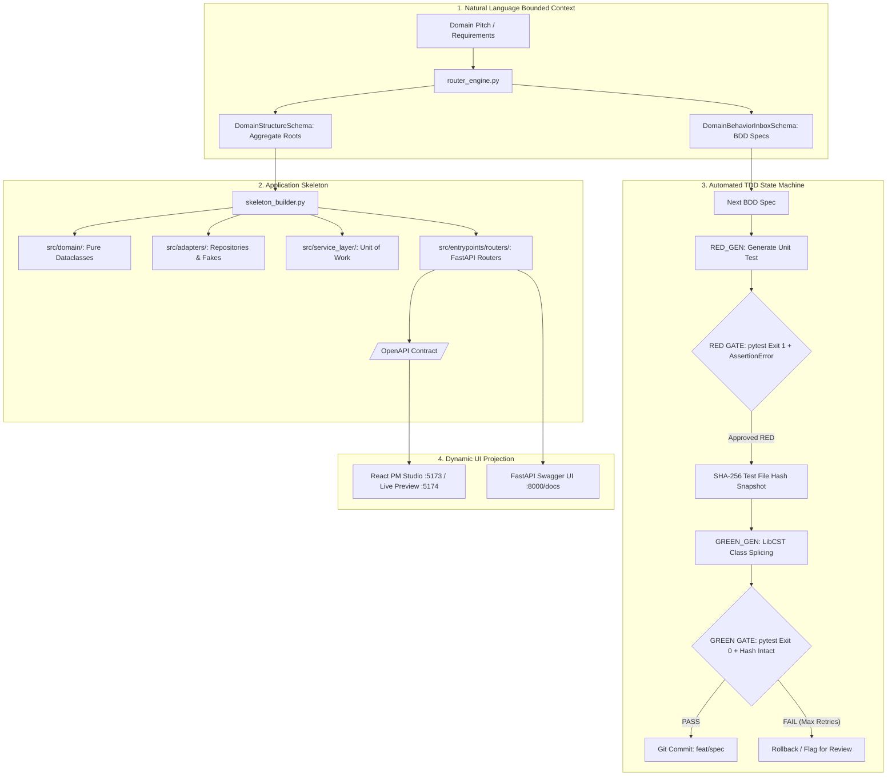

<div align="center">

# 🛡️ Provable

**Spec-Driven Code Generation Prototype with TDD Verification Loops & DDD Architecture**

*An experimental developer tool exploring test-driven feedback loops, AST code splicing, and bounded context architectures for LLM-assisted backend generation.*

[](https://www.python.org/)
[](https://nodejs.org/)
[](https://fastapi.tiangolo.com/)
[](https://vitejs.dev/)
[](https://www.docker.com/)
[](LICENSE)

[Architecture](#-system-architecture) •
[Quick Start](#-quick-start) •
[Services & Ports](#-services--live-endpoints) •
[Key Highlights](#-key-highlights--architectural-concepts) •
[Project Structure](#-project-structure)

</div>

---

## 📖 Overview

**Provable** is an experimental code generation engine designed to explore how strict **Test-Driven Development (TDD)** feedback loops and **Domain-Driven Design (DDD)** patterns can constrain and validate LLM-generated code.

Generating complete applications in single-shot prompts often results in context drift, subtle regressions, and unverified assumptions. Provable investigates an alternative, structured workflow:

1. **Domain Decomposition**: Breaks down natural language problem statements into structured aggregate roots and atomic BDD behavior specifications (`GIVEN / WHEN / THEN`).
2. **Red Gate (Test Generation)**: Generates targeted unit tests first, verifying via `pytest` that tests fail for the expected reason (preventing tautological passes).
3. **Integrity Lock (Hash Check)**: Snapshots test files with SHA-256 hashing to verify subsequent code-generation passes implement functionality rather than weakening or modifying test assertions.
4. **Green Gate & AST Splicing**: Uses Concrete Syntax Tree manipulation ([`libcst`](https://github.com/Instagram/LibCST)) to surgically inject generated methods into domain classes, verifying that the test suite turns green.
5. **Schema Projection**: Automatically surfaces data models via OpenAPI contracts and dynamic, schema-driven frontend components.

> **Project Status**: Provable is an exploratory prototype and architectural proof-of-concept. It serves as a testbed for studying automated verification harnesses, AST transforms, and bounded contexts as guardrails for AI coding assistants.

---

## ✨ Key Highlights & Architectural Concepts

- ⚡ **Automated TDD State Machine**: Programmatic `pytest` execution loop evaluating exit codes, enforcing authentic failures during RED phases, and applying execution timeouts.
- 🔒 **Test Integrity Verification (Hash Locks)**: Cryptographic hashing of test specifications before implementation passes to detect and prevent test tampering.
- 🧬 **Clean DDD Aggregate Boundaries**: Business logic isolated in pure dataclass aggregate roots, keeping core domain rules decoupled from web frameworks and databases.
- 📐 **AST-Based Code Splicing ([`libcst`](https://github.com/Instagram/LibCST))**: Concrete syntax tree parsing and class splicing to inject newly generated methods while preserving formatting, comments, and existing code structure.
- 🌐 **Schema-Driven UI Projection**: Dynamic frontend forms and views rendered directly from backend schemas, avoiding rigid domain hardcoding in the UI layer.
- 📊 **Integrated Allure Test Reporting**: Dockerized Allure service for visual test execution history and BDD behavior tracking.
- 🚀 **Unified Runner Script**: Cross-platform launcher (`run.py`) to manage local Python/Node dependencies and multi-service development environments.

---

## 🏗️ System Architecture



---

## 🚀 Quick Start

### 📋 Prerequisites

Before running Provable, ensure the host machine has the following tools installed:

1. **Python 3.11+** (Added to system `PATH`)
2. **Node.js 18+** & **npm** (Added to system `PATH`)
3. **Docker Desktop** (Running, for containerized Allure reporting)

### ⚡ Launching the Application (Single Command)

Provable features a unified, cross-platform runner script (`run.py`) that auto-detects your environment, installs/upgrades all Python and Node dependencies, starts the Docker container, and launches all background development servers.

Run the launcher for your environment:

#### Windows (PowerShell / Command Prompt)
```powershell
python run.py
```

#### Linux / WSL / macOS
```bash
python3 run.py
```

---

## 🌐 Services & Live Endpoints

Once launched, the following services will be available:

| Service | Endpoint | Description |
| :--- | :--- | :--- |
| **PM Studio Frontend** | [`http://localhost:5173`](http://localhost:5173) | Domain Bounded Context & Behavior Inbox Studio |
| **FastAPI Backend API** | [`http://localhost:8000`](http://localhost:8000) | REST API engine, DDD services & orchestration |
| **Interactive API Docs** | [`http://localhost:8000/docs`](http://localhost:8000/docs) | Generated OpenAPI Swagger documentation |
| **Allure Test Dashboard** | [`http://localhost:5050`](http://localhost:5050) | Containerized test results & BDD matrix dashboard |
| **Workspace Live Preview** | [`http://localhost:5174`](http://localhost:5174) | Sandbox live preview server for the target app |

---

## 📂 Project Structure

```
provable/
├── backend/                  # FastAPI backend engine & DDD orchestrator
│   ├── adapters/             # Repository Pattern & Workspace adapters
│   ├── config/               # Runtime configuration (integrations.yaml)
│   ├── db/                   # SQLite DataStore wrapper & schema migrations (store.py)
│   ├── domain/               # Core domain entities & business exceptions
│   ├── entrypoints/          # REST API routers (specs, kickstart, onboarding, requirements)
│   ├── onboarding/           # Domain router engine, skeleton builder, LibCST isolator
│   ├── prompts/              # System prompt templates for LLM agents
│   ├── service_layer/        # Unit of Work, message bus, and TDD state machine
│   └── tests/                # Unit, integration, and E2E test suites (124+ tests)
├── frontend/                 # PM Studio React 18 + Vite frontend
│   ├── src/                  # React TypeScript source
│   │   ├── components/       # KickstartStudio, BehaviorInboxPanel, RequirementControlPanel, AppPreview
│   │   └── App.tsx           # Main application shell
├── vault/                    # Comprehensive Obsidian knowledge base & architectural records
│   ├── 01-Architecture/      # System architecture, DDD patterns, schema-driven UI
│   ├── 02-Workflows/         # TDD workflows, verification pipelines, roadmap
│   ├── 04-Decisions/         # Architectural Decision Records (ADRs)
│   └── Home.md               # Vault sitemap & wiki index
├── docker-compose.allure.yaml# Docker Compose manifest for Allure reporting service
├── run.py                    # Unified single cross-platform launcher script
├── run.ps1                   # Windows PowerShell launcher wrapper
└── run.sh                    # Linux/WSL shell launcher wrapper
```

---

## 📄 License

This project is licensed under the [MIT License](LICENSE).
