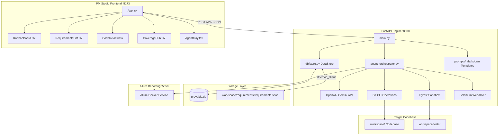

<div align="center">

# 🛡️ Provable

**Requirements-Driven Agentic Engineering Simulation Platform**

*Autonomous Developer Agents orchestrating Test-Driven Development, Visual QA, and BDD Specification Verification.*

[](https://www.python.org/)
[](https://nodejs.org/)
[](https://fastapi.tiangolo.com/)
[](https://vitejs.dev/)
[](https://www.docker.com/)
[](LICENSE)

[Architecture](#-system-architecture) •
[Quick Start](#-quick-start) •
[Services & Ports](#-services--live-endpoints) •
[Key Features](#-key-features) •
[Project Structure](#-project-structure)

</div>

---

## 📖 Overview

**Provable** is an agentic software development simulation platform. It bridges Product Management and Autonomous Software Engineering by orchestrating LLM developer agents within a strict, **Requirements-Driven Test-Driven Development (TDD)** environment.

With Provable, PMs define project specifications, requirements, and test triggers through a React PM Studio interface. Autonomous developer agents (powered by LangGraph, OpenAI/Gemini, and pytest) generate solution code, run unit/integration tests, capture visual screenshots via Selenium, evaluate UI layout regressions with Vision models, and publish coverage metrics to a containerized Allure Dashboard.

---

## ✨ Key Features

- ⚡ **Requirements-Driven TDD Workflow**: Bidirectional synchronization between StrictDoc specification files (`.sdoc`) and a high-performance SQLite DataStore.
- 🤖 **Autonomous Agent Orchestration**: LangGraph-powered execution loops for code generation, test execution, visual regression check, and git branch finalization/rollback.
- 👁️ **Dual-Resolution Visual QA**: Automated headless Selenium screenshot capture (desktop `1280x800` & mobile `375x812`) evaluated by Gemini Vision.
- 📊 **Containerized Allure Dashboard**: Live test execution matrices and coverage analytics rendered via an embedded Allure Docker service.
- 🚀 **Single-Command Launch**: Zero-friction setup script that automatically detects OS environment (Windows / Linux / WSL), resolves dependencies, and manages containerized services.

---

## 🏗️ System Architecture



---

## 🚀 Quick Start

### 📋 Prerequisites

Before running Provable, ensure the host machine has the following tools installed:

1. **Python 3.11+** (Added to system `PATH`)
2. **Node.js 18+** & **npm** (Added to system `PATH`)
3. **Docker Desktop** (Running, for containerized Allure reporting)

---

### ⚡ Launching the Application (Single Command)

Provable features a unified, cross-platform runner script (`run.py`) that auto-detects your environment, installs/upgrades all Python and Node dependencies, starts the Docker container, and launches all background development servers.

Run the launcher for your environment:

#### Windows (PowerShell / Command Prompt)
```powershell
python run.py
# or
.\run.ps1
```

#### Linux / WSL / macOS
```bash
python3 run.py
# or
./run.sh
```

---

### 🛠️ What the Launcher Automates
When `run.py` is executed, it automatically performs the following tasks:
1. **Host Prerequisites Check**: Verifies that Python, Node/npm, and Docker are present in `PATH`.
2. **Python Dependencies**: Installs and upgrades all required packages (`fastapi`, `uvicorn`, `langgraph`, `openai`, `pydantic`, `sqlalchemy`, `aiosqlite`, `selenium`, `pytest`, etc.).
3. **Node Dependencies**: Detects missing `node_modules/` and runs `npm install` automatically.
4. **Allure Docker Service**: Launches the containerized Allure Dashboard on port `5050` using `docker-compose.allure.yaml`.
5. **Service Management**: Launches the FastAPI backend API on port `8000` and the Vite frontend on port `5173`.

---

## 🌐 Services & Live Endpoints

Once launched, the following services will be available:

| Service | Endpoint | Description |
| :--- | :--- | :--- |
| **PM Studio Frontend** | [`http://localhost:5173`](http://localhost:5173) | Main React/TypeScript interface for requirements & agent review |
| **FastAPI Backend API** | [`http://localhost:8000`](http://localhost:8000) | REST API engine, SSE log streaming & orchestration |
| **Interactive API Docs** | [`http://localhost:8000/docs`](http://localhost:8000/docs) | OpenAPI Swagger documentation |
| **Allure Test Dashboard** | [`http://localhost:5050`](http://localhost:5050) | Containerized test results & BDD matrix dashboard |
| **Workspace Live Preview** | [`http://localhost:5174`](http://localhost:5174) | Sandbox live preview server for the target app |

---

## 📂 Project Structure

```
provable/
├── backend/                  # FastAPI backend engine
│   ├── config/               # Model routing & integration settings (models.yaml)
│   ├── db/                   # SQLite DataStore wrapper & schema migrations (store.py)
│   ├── integrations/         # Sync clients (strictdoc_client.py, allure_client.py)
│   ├── prompts/              # System prompt templates for LLM agents
│   ├── agent_orchestrator.py # LangGraph agent execution loop
│   └── main.py               # REST API endpoints & server startup
├── src/                      # PM Studio React + Vite frontend
│   ├── components/           # UI components (KanbanBoard, RequirementsList, DiffViewer, etc.)
│   ├── hooks/                # Data fetching and database mutation hooks
│   └── App.tsx               # Main application routing and shell
├── vault/                    # Project Obsidian documentation vault
│   ├── 01-Architecture/      # System architecture & database schemas
│   ├── 02-Workflows/         # LangGraph execution loop & TDD workflows
│   ├── 04-Decisions/         # Architectural Decision Records (ADRs)
│   └── Home.md               # Wiki sitemap & index
├── workspace/                # Target repository modified exclusively by developer agents
│   ├── requirements/         # StrictDoc specification files (.sdoc)
│   └── tests/                # Automated pytest BDD test suites
├── docker-compose.allure.yaml# Docker Compose manifest for Allure reporting service
├── run.py                    # Unified single cross-platform launcher script
├── run.ps1                   # Windows PowerShell launcher wrapper
└── run.sh                    # Linux/WSL shell launcher wrapper
```

---

## 📄 License

This project is licensed under the [MIT License](LICENSE).
