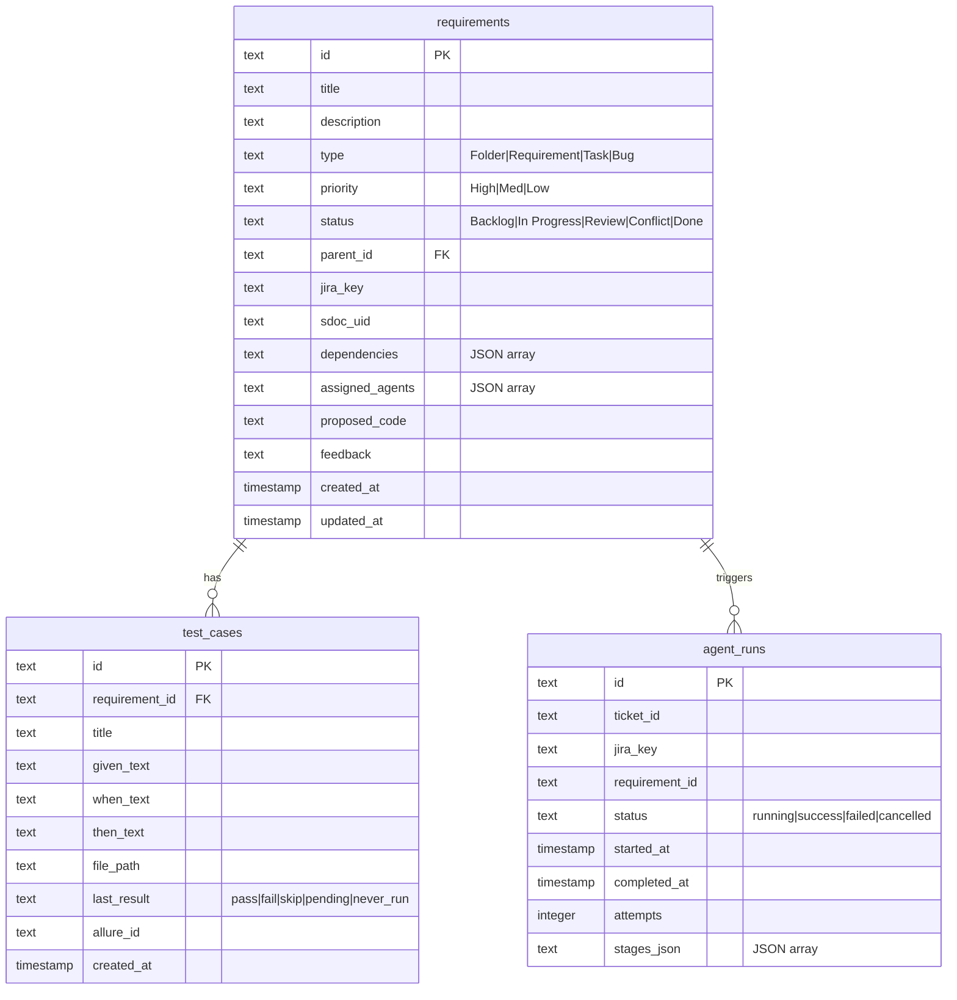

# Database Schema

Provable stores its application state in an SQLite database located at `backend/provable.db`. The database is managed by `backend/db/store.py` and is initialized using `backend/db/schema.sql`.



## Tables

### 1. `requirements`
Stores the project requirements hierarchy (folders, parent requirements, tasks, and bugs).
- **`id`** (`TEXT PRIMARY KEY`): Unique identifier (e.g., `REQ-1002`, `BUG-3963`).
- **`title`** (`TEXT`): Human-readable name.
- **`description`** (`TEXT`): Detailed specification or bug steps.
- **`type`** (`TEXT CHECK(type IN ('Folder','Requirement','Task','Bug'))`): Node type.
- **`priority`** (`TEXT`): Task priority (`High`, `Med`, `Low`).
- **`status`** (`TEXT`): Kanban stage (`Backlog`, `In Progress`, `Review`, `Conflict`, `Done`).
- **`parent_id`** (`TEXT REFERENCES requirements(id)`): Self-reference for hierarchical structuring.
- **`jira_key`** / **`sdoc_uid`** (`TEXT`): Sync reference keys for external integrations.
- **`dependencies`** (`TEXT`): JSON array of requirement IDs blocking this node.
- **`assigned_agents`** (`TEXT`): JSON array of agent roles (e.g. `["Frontend"]`, `["Backend"]`).
- **`proposed_code`** (`TEXT`): Draft code changes proposed by the developer agent.
- **`feedback`** (`TEXT`): Errors or run information.

### 2. `test_cases`
Stores individual test cases extracted from Python pytest code and AST docstring parsing.
- **`id`** (`TEXT PRIMARY KEY`): Unique test case identifier (e.g., `TST-2800`).
- **`requirement_id`** (`TEXT REFERENCES requirements(id)`): Reference to parent requirement.
- **`title`** (`TEXT`): Description of what the test case validates.
- **`given_text`** / **`when_text`** / **`then_text`** (`TEXT`): Given-When-Then blocks parsed from the test docstring.
- **`file_path`** (`TEXT`): File containing the test logic (e.g., `tests/test_example.py`).
- **`last_result`** (`TEXT CHECK(...)`): Latest execution status (`pass`, `fail`, `skip`, `pending`, `never_run`).
- **`allure_id`** (`TEXT`): ID mapped in Allure report portal.

### 3. `agent_runs`
Tracks history and runs of autonomous developer loops.
- **`id`** (`TEXT PRIMARY KEY`): Unique run session ID.
- **`ticket_id`** / **`jira_key`** / **`requirement_id`** (`TEXT`): References to the triggered node.
- **`status`** (`TEXT`): Run status (`running`, `success`, `failed`, `cancelled`).
- **`attempts`** (`INTEGER`): Number of code iterations.
- **`stages_json`** (`TEXT`): Log tracking steps completed within the LangGraph run.

## Triggers

### `requirements_updated_at`
Auto-updates the `updated_at` timestamp of modified requirements.
```sql
CREATE TRIGGER IF NOT EXISTS requirements_updated_at
    AFTER UPDATE ON requirements
    FOR EACH ROW
    BEGIN
        UPDATE requirements SET updated_at = CURRENT_TIMESTAMP WHERE id = OLD.id;
    END;
```
