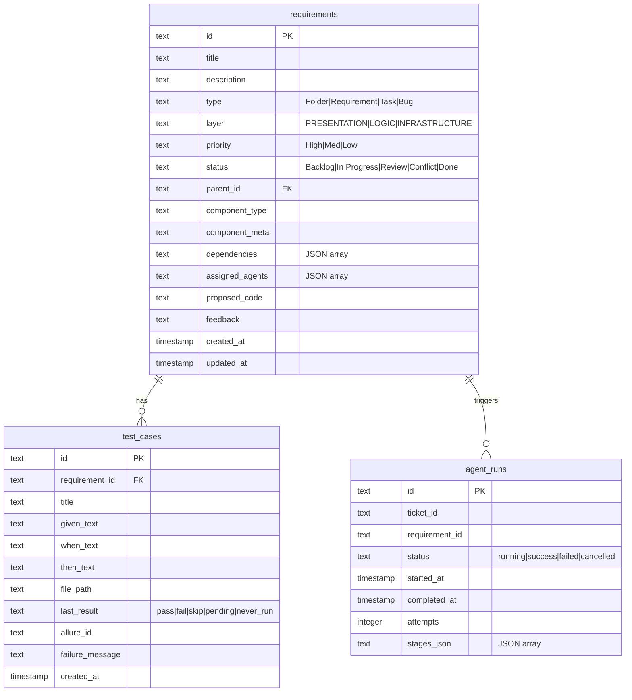

# Database Schema & DataStore API

Provable manages its application state using an SQLite database located dynamically per-project under `workspace/requirements/provable.db`. All database interactions are encapsulated by `backend/db/store.py` and initialized using SQL definitions in `backend/db/schema.sql`.



---

## Verbatim Database DDL (`backend/db/schema.sql`)

```sql
-- Provable data schema
CREATE TABLE IF NOT EXISTS requirements (
    id          TEXT PRIMARY KEY,
    title       TEXT NOT NULL,
    description TEXT DEFAULT '',
    type        TEXT CHECK(type IN ('Folder','Requirement','Task','Bug')),
    layer       TEXT CHECK(layer IN ('PRESENTATION','LOGIC','INFRASTRUCTURE')) DEFAULT 'LOGIC',
    priority    TEXT DEFAULT 'Med',
    status      TEXT DEFAULT 'Backlog',
    parent_id   TEXT REFERENCES requirements(id),
    component_type TEXT DEFAULT 'custom',
    component_meta TEXT DEFAULT '{}',
    jira_key    TEXT,
    sdoc_uid    TEXT,
    dependencies TEXT DEFAULT '[]',   -- JSON array of requirement IDs
    assigned_agents TEXT DEFAULT '[]',-- JSON array of agent roles
    proposed_code TEXT,
    feedback    TEXT DEFAULT '',
    created_at  TIMESTAMP DEFAULT CURRENT_TIMESTAMP,
    updated_at  TIMESTAMP DEFAULT CURRENT_TIMESTAMP
);

CREATE TABLE IF NOT EXISTS test_cases (
    id              TEXT PRIMARY KEY,
    requirement_id  TEXT REFERENCES requirements(id),
    title           TEXT NOT NULL,
    given_text      TEXT DEFAULT '',
    when_text       TEXT DEFAULT '',
    then_text       TEXT DEFAULT '',
    file_path       TEXT,
    last_result     TEXT CHECK(last_result IN ('pass','fail','skip','pending','never_run')) DEFAULT 'never_run',
    allure_id       TEXT,
    failure_message TEXT,
    created_at      TIMESTAMP DEFAULT CURRENT_TIMESTAMP
);

CREATE TABLE IF NOT EXISTS agent_runs (
    id              TEXT PRIMARY KEY,
    ticket_id       TEXT,
    jira_key        TEXT,
    requirement_id  TEXT,
    status          TEXT CHECK(status IN ('running','success','failed','cancelled')) DEFAULT 'running',
    started_at      TIMESTAMP DEFAULT CURRENT_TIMESTAMP,
    completed_at    TIMESTAMP,
    attempts        INTEGER DEFAULT 0,
    stages_json     TEXT DEFAULT '[]'
);

-- Trigger to auto-update updated_at on requirements
CREATE TRIGGER IF NOT EXISTS requirements_updated_at
    AFTER UPDATE ON requirements
    FOR EACH ROW
    BEGIN
        UPDATE requirements SET updated_at = CURRENT_TIMESTAMP WHERE id = OLD.id;
    END;
```

---

## DataStore API Specification (`backend/db/store.py`)

The `store.py` module manages SQLite operations and triggers bidirectional sync:

- **`get_all_requirements()` / `get_requirement(req_id)` / `create_requirement(data)` / `update_requirement(req_id, updates)` / `delete_requirement(req_id)`**
- **`get_test_cases_for_requirement(req_id)` / `create_test_case(data)` / `update_test_case_result(test_id, result, failure_msg)`**
- **`save_kickstart_state(pitch, domain_model, synthesized, entity_schemas, custom_fixtures)` / `get_kickstart_state()`**
- **`save_active_project(name, path, settings)` / `list_projects()` / `wipe_database()`**

---

## 🏛️ Architectural Invariants & Dynamic Schema Storage

> [!NOTE]
> **Dynamic Bounded Context JSON Storage**: To support rapidly evolving, dynamic Bounded Contexts, we strictly utilize JSON blob columns in SQLite rather than normalized relational EAV (Entity-Attribute-Value) tables. This provides NoSQL-like flexibility with SQLite's ACID guarantees.


---

## 🔗 Related Documentation
- [[System Architecture]]
- [[Backend REST API]]
- [[Enterprise-AppGen-TDD-Engine-Architecture]]

