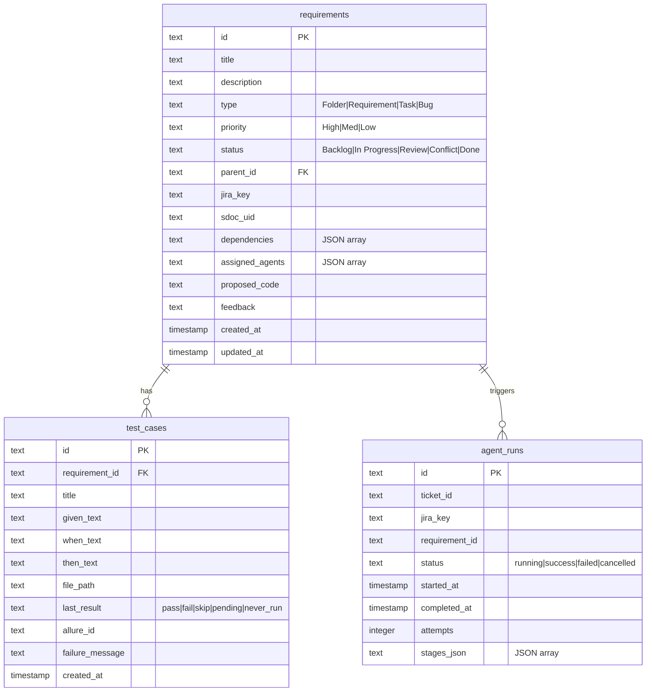

# Database Schema & DataStore API

Provable manages its application state using an SQLite database located at `backend/provable.db`. All database interactions are encapsulated by `backend/db/store.py` (`DataStore` class) and initialized using SQL definitions in `backend/db/schema.sql`.



---

## Verbatim Database DDL (`backend/db/schema.sql`)

To deterministically recreate `provable.db`, execute the following DDL script:

```sql
-- Provable data schema
CREATE TABLE IF NOT EXISTS requirements (
    id              TEXT PRIMARY KEY,
    title           TEXT NOT NULL,
    description     TEXT DEFAULT '',
    type            TEXT CHECK(type IN ('Folder','Requirement','Task','Bug')),
    priority        TEXT DEFAULT 'Med',
    status          TEXT DEFAULT 'Backlog',
    parent_id       TEXT REFERENCES requirements(id),
    jira_key        TEXT,
    sdoc_uid        TEXT,
    dependencies    TEXT DEFAULT '[]',   -- JSON array of requirement IDs
    assigned_agents TEXT DEFAULT '[]',-- JSON array of agent roles
    proposed_code   TEXT,
    feedback        TEXT DEFAULT '',
    created_at      TIMESTAMP DEFAULT CURRENT_TIMESTAMP,
    updated_at      TIMESTAMP DEFAULT CURRENT_TIMESTAMP
);

CREATE TABLE IF NOT EXISTS test_cases (
    id              TEXT PRIMARY KEY,
    requirement_id  TEXT REFERENCES requirements(id),
    title           TEXT NOT NULL,
    given_text      TEXT DEFAULT '',
    when_text       TEXT DEFAULT '',
    then_text       TEXT DEFAULT '',
    file_path       TEXT,
    last_result     TEXT CHECK(last_result IN ('pass','fail','skip','pending','never_run')) DEFAULT 'never_run',
    allure_id       TEXT,
    failure_message TEXT,
    created_at      TIMESTAMP DEFAULT CURRENT_TIMESTAMP
);

CREATE TABLE IF NOT EXISTS agent_runs (
    id              TEXT PRIMARY KEY,
    ticket_id       TEXT,
    jira_key        TEXT,
    requirement_id  TEXT,
    status          TEXT CHECK(status IN ('running','success','failed','cancelled')) DEFAULT 'running',
    started_at      TIMESTAMP DEFAULT CURRENT_TIMESTAMP,
    completed_at    TIMESTAMP,
    attempts        INTEGER DEFAULT 0,
    stages_json     TEXT DEFAULT '[]'
);

-- Trigger to auto-update updated_at on requirements
CREATE TRIGGER IF NOT EXISTS requirements_updated_at
    AFTER UPDATE ON requirements
    FOR EACH ROW
    BEGIN
        UPDATE requirements SET updated_at = CURRENT_TIMESTAMP WHERE id = OLD.id;
    END;
```

---

## DataStore API Specification (`backend/db/store.py`)

The `DataStore` Python class manages all SQLite operations and triggers bidirectional sync.

### Class Method Signatures

```python
class DataStore:
    def __init__(self, db_path: str = "backend/provable.db"): ...
    def init_db(self) -> None: ...
    
    # Requirement Operations
    def get_all_requirements(self) -> list[dict]: ...
    def get_requirement(self, req_id: str) -> dict | None: ...
    def add_requirement(self, req_data: dict) -> dict: ...
    def update_requirement(self, req_id: str, updates: dict) -> dict | None: ...
    def delete_requirement(self, req_id: str) -> bool: ...
    
    # Test Case Operations
    def get_test_cases_for_requirement(self, req_id: str) -> list[dict]: ...
    def add_test_case(self, test_data: dict) -> dict: ...
    def update_test_case_result(self, test_id: str, result: str, failure_msg: str = "") -> None: ...
    
    # Agent Run Operations
    def create_agent_run(self, ticket_id: str, req_id: str) -> str: ...
    def update_agent_run_stage(self, run_id: str, stage_name: str, status: str, details: dict = None) -> None: ...
    def finalize_agent_run(self, run_id: str, final_status: str, attempts: int) -> None: ...
    
    # Review & Merge Operations
    def get_review_queue(self) -> list[dict]: ...
    def approve_and_merge(self, req_id: str) -> bool: ...
    def reject_submission(self, req_id: str, feedback_msg: str) -> bool: ...
```
