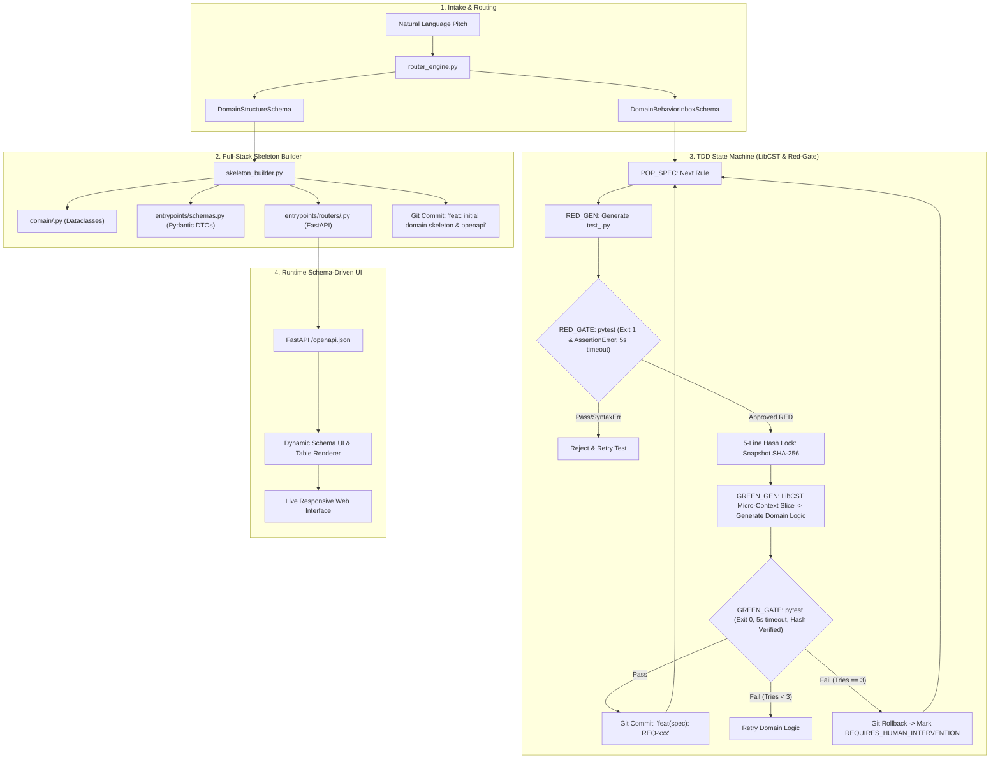

# Enterprise AppGen TDD & DDD Engine Architecture

## 1. Executive Summary & Core Invariant
Enterprise AppGen eliminates AI hallucination, context drift, and technical debt by replacing unstructured free-text iterative prompting with a deterministic **TDD (Test-Driven Development) & DDD (Domain-Driven Design)** state machine.

---

## 2. The 7 Core Architectural & Safety Directives

### 1. Runtime Schema-Driven UI (Zero Static React Scaffolding)
- **100% Runtime Dynamic UI**: No static React component code is generated during build time or iterative loops.
- **OpenAPI / JSON Schema Form**: The UI is dynamically rendered at runtime via `@rjsf/core` (React JSON Schema Form) or dynamic schema tables driven directly by FastAPI’s `/openapi.json`.
- **Zero Frontend LLM Involvement**: LLM focus is 100% reserved for pure Python domain logic and architecture.

### 2. Pytest-First with Parameterized Tests
- **Standard Pytest Default**: Test generation defaults to standard `pytest` functions, utilizing `@pytest.mark.parametrize` for table-driven scenarios.
- **Opt-In Hypothesis**: `hypothesis` property-based testing is strictly opt-in, triggered only when the Router-LLM flags a rule as a mathematical, arithmetic, or cryptographic boundary invariant.

### 3. LibCST Code Isolation (`cst_isolator.py`)
- **Meta LibCST**: Built-in `ast` is discarded in favor of `libcst`.
- **Preserved Formatting**: Extracts and splices Aggregate Root classes while strictly preserving whitespace, comments, indentation, and docstrings.

### 4. The 5-Line Hash Lock Anti-Cheat (`tdd_machine.py`)
- **Anti-Tampering Invariant**: During the `GREEN_GEN` phase, a SHA-256 cryptographic hash of `test_<spec_id>.py` is snapshotted (`compute_test_file_hash`).
- After code generation / splicing, the hash is re-verified (`verify_test_file_integrity`). If the hash changed, a `TestTamperingError` is raised immediately.
- Eliminates brittle OS-level filesystem locks (`chmod`) across platforms.

### 5. Pytest Execution Hard Timeout
- **Hanging Protection**: Pytest executions enforce a hard 5-second timeout (`pytest-timeout`).
- Timeouts or infinite loops (e.g. `while True:`) are treated as Exit Code 2 execution errors, triggering immediate rejection and rollback.

### 6. Full-Stack Skeleton from Second Zero
- **Instant OpenAPI Contract**: `skeleton_builder.py` immediately scaffolds domain classes, Pydantic DTOs (`schemas.py`), and basic FastAPI routers (`entrypoints/routers/`).
- `/openapi.json` is available from iteration 1 to immediately power the runtime UI.

### 7. 3-Strike Dead-End Handling & Rollback
- **Safety Fallback**: If the GREEN phase fails after 3 consecutive repair attempts:
  1. Automatic Git rollback (`git reset --hard`) to the state immediately preceding the RED phase.
  2. The specification in SQLite is flagged with status `REQUIRES_HUMAN_INTERVENTION`.
  3. The error is logged and the engine automatically pops the next specification (`POP_SPEC`).

---

## 3. Active Architecture Implementation

> [!NOTE]
> **LLM-Driven LibCST Splicing (GREEN Phase)**: The GREEN phase uses `synthesize_green_class_implementation` powered by `gemini-2.5-flash` to synthesize domain class modifications directly against the LibCST micro-context and failing pytest `AssertionError` with strict SHA-256 hash lock verification.

> [!NOTE]
> **Runtime Schema-Driven UI Dynamic Projection**: Runtime Schema-Driven UI via FastAPI `/openapi.json` and `@rjsf/core` in `SchemaDrivenAppPreview.tsx` completely eliminates frontend LLM hallucinations and secondary Vite dev server dependencies, projecting reactive forms and live entity data directly from backend contracts.

---

## 4. Pillar Breakdown & Workflow Diagram

---

## 5. Cross-References
- [[System Architecture]]
- [[Shift-Left TDD Workflow]]
- [[Automated-Verification-And-Self-Healing-Pipeline]]

