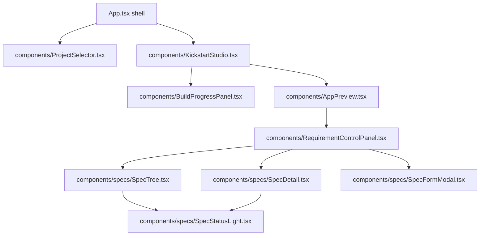

# Frontend Components

PM Studio ([`frontend/src/`](../../frontend/src)) is a React 18 + TypeScript + Vite app. It is one screen: the generated app beside its specifications. It knows nothing about any particular generated app.

## Component map

## Components

- **`App.tsx`**: the header (product name, project selector) and the studio. Switching project remounts the studio.
- **`components/KickstartStudio.tsx`**: decides which of two views is shown. Nothing built yet: one question as the headline and a composer (text box with a Build button, Ctrl + Enter builds) (`POST /api/onboarding/kickstart`). Otherwise, and from the moment a build starts: the app preview, with the build progress banner above it while the build runs. The preview is reloaded when the build delivers the first draft and again when it delivers the written page. It also owns the workspace reset (`POST /api/onboarding/reset`).
- **`components/BuildProgressPanel.tsx`**: the build progress banner, read from `GET /api/onboarding/progress`: how far the build has come in percent, what is being worked on, one bar, and the stages by name (collapsible, collapsed at first on a narrow screen). See "The build progress bar" below.
- **`components/AppPreview.tsx`**: the live workspace (an iframe on the generated app's dev server, :5174) beside the specifications panel, always side by side. Its toolbar holds reset, reload and open-in-new-tab. While a build runs the app is shown as being worked on (muted, a slow band of light over it, still usable); when the build ends it steps forward with a short pop.
- **`components/RequirementControlPanel.tsx`**: loads the Living Rule Deck (`GET /api/specs/deck`, polled) and owns add, edit, delete and Run Test (`POST /api/specs/inbox/{id}/execute`). It renders the three `specs/` components.
- **`components/specs/SpecTree.tsx`**: the specifications grouped by chapter, collapsible.
- **`components/specs/SpecDetail.tsx`**: the selected specification: title, behaviour (Given / When / Then / Unless), Edit, Delete and Run Test.
- **`components/specs/SpecFormModal.tsx`**: the add and edit form.
- **`components/specs/SpecStatusLight.tsx`**: the test light (see below).
- **`components/StatusMessage.tsx`**: a short outcome message with a typed severity (`success`, `warning`, `error`). Severity is stated by the code that reports it, never read out of the message text.
- **`components/ProjectSelector.tsx`**: lists, switches and adds projects (`/api/projects`).

## The test light

Every specification shows one light, in the tree and next to its title. It only reports the outcome of the spec's last test run:

| Light | `test_status` | Meaning |
| --- | --- | --- |
| Grey | `not_run` | No run has ended for this spec |
| Green | `pass` | The change was proved |
| Yellow | `broken` | The run stopped before the behaviour could be judged (test rejected, domain did not import, provider error, no view to change) |
| Red | `fail` | A verifying step judged the change and rejected it |

The backend derives the status (`backend/onboarding/spec_test_status.py`) and serves it on every deck card together with `test_reason`, one line shown under the title when the light is yellow or red. The Studio does not interpret pipeline statuses itself.

Editing a spec does not clear its stored result, so the light shows the last run until Run Test is pressed again.

While a build is working on a spec (its id is in the progress report's `rules.waiting`), its light pulses in the accent colour instead, and turns to one of the four above when the spec is settled.

## The build progress bar

The bar is cut into one segment per stage of a build, all of them from the start. The Studio only draws what the backend reports (`backend/onboarding/build_progress.py`); it computes nothing itself.

- **A segment's length** is the stage's `weight`: its usual share of a build's time. The backend learns it from the recorded runs (`backend/onboarding/stage_timing.py`): the mean duration of each stage over the kickstarts under `logs/runs/` that went well, divided by the sum over all stages. No durations are kept by hand, and since the recorder keeps a bounded number of runs the weights follow the pipeline as it changes.
- **Shares of work, not of the clock.** Stages that run side by side each keep their own segment and fill at the same time.
- **A segment's fill** is the stage's `fraction`: full once the stage ended (red when it failed), and while it runs the time it has spent against the time it usually takes, never more than full.
- **The percentage** is the sum of weight times fraction.
- **No recorded build yet:** every stage weighs the same, and a running stage adds nothing until it ends. A stage the recorded builds never ran weighs as an average stage.

Until the skeleton is written (about a minute into a build) the workspace has nothing of the new app to show: the preview shows the blank workspace page from `backend/onboarding/templates/workspace_scaffold.py`.

## Layout and styling

- Styles live in `frontend/src/index.css` as classes on CSS variables; components carry no layout in inline styles, so media queries can change it.
- Below 768px the layout stacks: a square preview as wide as the screen, the specifications below it (tree, then detail), and one scroll for both.
- Icons come from `@mui/icons-material`, used sparingly on actions. No emoji in the UI. All UI text is English.

## Related

- [[System Architecture]]
- [[PM-Studio-UX-Architecture-And-Direction]]
- [[Automated-Verification-And-Self-Healing-Pipeline]]
