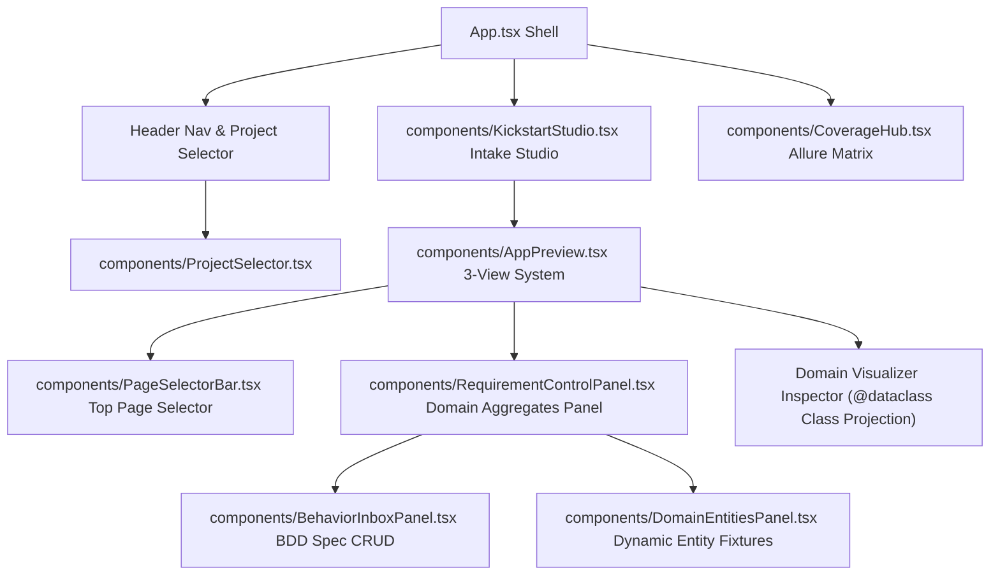

# Frontend Components

The PM Studio frontend ([`frontend/src/`](../../frontend/src)) is a modern React 18 application built with TypeScript, Vite, and custom CSS design system tokens.

---

## 🧩 Component Sitemap

---

## 📦 Component Descriptions

### 1. `frontend/src/App.tsx` (Application Shell)
- **Responsibility**: Top-level layout manager, project banner, and global view state router (`Domain`, `Requirements`, `Tests`).

### 2. `frontend/src/components/KickstartStudio.tsx` (Bounded Context Studio)
- **Responsibility**: Intake form accepting industrial bounded context descriptions, triggering synthesis via `POST /api/onboarding/kickstart`, and initiating physical workspace resets (`POST /api/onboarding/reset`).

### 3. `frontend/src/components/AppPreview.tsx` (3-View Workspace System)
- **Responsibility**: 3-in-1 workspace system providing:
  1. `Preview`: Live Vite sandbox iframe (`http://localhost:5174/`).
  2. `API (Swagger)`: Embedded FastAPI OpenAPI Swagger UI (`http://localhost:8000/docs`).
  3. `Domain`: Abstract JSON-driven schema visualizer presenting Python Aggregate dataclasses (`Pallet`, `Zone`, `Operator`), attributes, types, invariants, and method signatures without client-side AST parsing.

### 4. `frontend/src/components/BehaviorInboxPanel.tsx` (BDD Specification Inbox)
- **Responsibility**: Structured specification inbox for managing atomic business rules (`GIVEN / WHEN / THEN`), target aggregate binding, mathematical boundary flags, and execution status (`PENDING`, `IN_PROGRESS`, `FULFILLED`, `REQUIRES_HUMAN_INTERVENTION`).

### 5. `frontend/src/components/RequirementControlPanel.tsx` (Domain Aggregates Panel)
- **Responsibility**: Collapsible tree inspector for active domain aggregates, inline BDD spec creation forms, and attribute schema controls.

### 6. `frontend/src/components/DomainEntitiesPanel.tsx` (Dynamic Entity Fixtures)
- **Responsibility**: Dynamic CRUD panel for entity data instances bound directly to schema attribute metadata.

### 7. `frontend/src/components/CoverageHub.tsx` (Coverage Matrix)
- **Responsibility**: Embeds the containerized Allure reporting dashboard (`http://localhost:5050/allure-docker-service/projects/default/reports/latest/index.html`).

---

## 🏛️ Discrepancies & Evolution Tags

> [!NOTE]
> [DISCREPANCY: Doc approach better - The original PM Studio architecture envisioned a 100% dumb schema-driven UI using `@rjsf/core` directly rendering forms from `/openapi.json` with zero custom hardcoded DOM structures. While the active React frontend has been cleaned of domain keywords, it currently uses a hybrid iframe (:5174) and custom table visualizer rather than a pure `@rjsf/core` schema form runner.]

---

## 🔗 Related Documentation
- [[System Architecture]]
- [[PM-Studio-UX-Architecture-And-Direction]]
- [[Automated-Verification-And-Self-Healing-Pipeline]]

