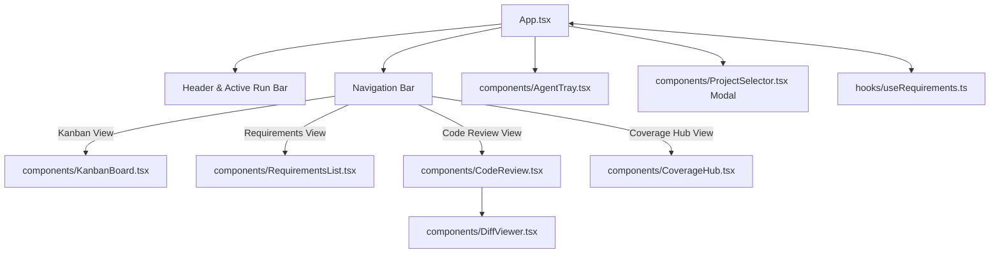

# Frontend Component Architecture & TypeScript Contracts

The PM Studio frontend (`src/`) is built using React 18, TypeScript, and Vite. It provides an intuitive interface for Project Managers to define requirements, generate failing TDD tests, trigger autonomous developer agents, review git diffs, and inspect live Allure coverage reports.



---

## TypeScript Domain Model Contracts

To deterministically recreate the frontend interfaces, implement these TypeScript types:

```typescript
export type RequirementType = 'Folder' | 'Requirement' | 'Task' | 'Bug';
export type PriorityLevel = 'High' | 'Med' | 'Low';
export type KanbanStatus = 'Backlog' | 'In Progress' | 'Review' | 'Conflict' | 'Done';
export type TestResultStatus = 'pass' | 'fail' | 'skip' | 'pending' | 'never_run';

export interface TestCase {
  id: string;
  requirement_id: string;
  title: string;
  given_text?: string;
  when_text?: string;
  then_text?: string;
  file_path: string;
  last_result: TestResultStatus;
  allure_id?: string;
  failure_message?: string;
}

export interface Requirement {
  id: string;
  title: string;
  description: string;
  type: RequirementType;
  priority: PriorityLevel;
  status: KanbanStatus;
  parent_id: string | null;
  jira_key?: string;
  sdoc_uid?: string;
  dependencies: string[];
  assigned_agents: string[];
  proposed_code?: string;
  feedback?: string;
  created_at: string;
  updated_at: string;
  test_cases?: TestCase[];
}

export interface AgentRunStage {
  stage: 'prepare_branch' | 'code_generation' | 'test_runner' | 'visual_qa' | 'finalize';
  status: 'running' | 'success' | 'failed';
  timestamp: string;
  details?: string;
}

export interface AgentStatusResponse {
  ticket_id: string;
  status: 'running' | 'success' | 'failed' | 'idle';
  current_stage: string;
  attempts: number;
  max_attempts: number;
  stages: AgentRunStage[];
  logs: string[];
}
```

---

## Core Components Breakdown

### 1. `App.tsx` (Main Shell)
- **Role**: Root container managing tab switching (`kanban`, `requirements`, `review`, `coverage`), active workspace state, and global agent run notifications.

### 2. `components/KanbanBoard.tsx`
- **Role**: Renders 5 Kanban status columns (`Backlog`, `In Progress`, `Review`, `Conflict`, `Done`).
- **Features**: Card badges, status dropdowns, and "Fix Failing Test" action buttons.

### 3. `components/RequirementsList.tsx`
- **Role**: Hierarchical tree explorer for folder structures.
- **Features**: Tree expansion controls, full node CRUD, parent dropdowns, dependency tag selection, and "Create Test Case" TDD triggers.

### 4. `components/CodeReview.tsx` & `components/DiffViewer.tsx`
- **Role**: Code review station displaying side-by-side git diffs (`DiffViewer`) and pytest logs.
- **Actions**: Approve (Merge to Main) and Reject (Revert Branch).

### 5. `components/CoverageHub.tsx`
- **Role**: Requirement traceability matrix table and embedded Allure Docker portal (`http://localhost:5050`).

### 6. `components/AgentTray.tsx`
- **Role**: Collapsible bottom tray displaying active LangGraph node step, attempt count, and streaming log stdout.
