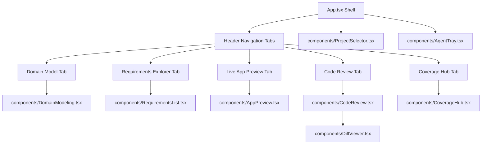

# Frontend Components

The PM Studio frontend ([`src/`](file:///c:/Users/ahlst/Documents/GitHub/provable/src/)) is a modern React 18 application built with TypeScript, Vite, and custom CSS design system tokens ([`src/index.css`](file:///c:/Users/ahlst/Documents/GitHub/provable/src/index.css)).

---

## 🧩 Component Sitemap

---

## 📦 Component Descriptions

### 1. `src/App.tsx` (Application Shell)
- **Responsibility**: Top-level layout manager, header navigation tab router (`domain`, `requirements`, `live-app`, `review`, `coverage`), active project banner, and global toasts.
- **Project Reset Mechanism**: Invokes `/api/projects/reset-all` without blocking native browser popups, updating status non-blocking toast notifications.

### 2. `src/components/DomainModeling.tsx` (Domain Discovery Canvas)
- **Responsibility**: Interactive pitch discovery input, pitch-specific Mermaid class & sequence diagram rendering, 6-part DDD domain specification canvas, and 1-click domain stack synthesis trigger.

### 3. `src/components/AppPreview.tsx` (Live App Web Preview)
- **Responsibility**: Embedded iframe preview component hosting the target workspace's Vite dev server (`http://localhost:5174/`).
- **Features**:
  - Dual-port server selector (Vite Preview `:5174` vs FastAPI Backend `:8000`).
  - Device viewport modes (Desktop 100%, Tablet 768px, Mobile 375px).
  - 1-click iframe refresh and popout to external browser tab.
  - CSS flex-column height fit preventing iframe layout collapse.

### 4. `src/components/RequirementsList.tsx` (Hierarchical Requirements Explorer)
- **Responsibility**: Tree-view explorer for ISO 29148 requirements, BDD test scenarios, and developer agent ticket dispatches.

### 5. `src/components/CodeReview.tsx` & `src/components/DiffViewer.tsx`
- **Responsibility**: Code review queue rendering side-by-side git diffs, pytest failure logs, and 1-click merge approvals.

### 6. `src/components/CoverageHub.tsx`
- **Responsibility**: Embeds the containerized Allure reporting dashboard (`http://localhost:5050/allure-docker-service/projects/default/reports/latest/index.html`).

---

## 🔗 Related Documentation
- [[System Architecture]]
- [[Automated-Verification-And-Self-Healing-Pipeline]]
- [[Universal-Dynamic-Domain-AST-Generator]]
