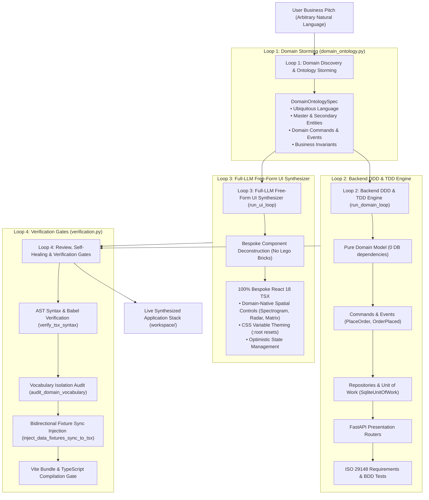

# Full-LLM Free-Form Software Synthesis & Orchestration Graph

## 1. Overview & Architectural Shift

Provable operates as a **Pure Full-LLM Free-Form Software Synthesizer**. Unlike traditional low-code generators that force business concepts into pre-baked "lego-block" components (such as rigid catalogs, shopping carts, or generic data tables), Provable synthesizes 100% bespoke, domain-native React 18 frontend interfaces and DDD backend stacks directly from domain mechanics and ubiquitous language.

---

## 2. The Multi-Loop Orchestration Graph

The software generation pipeline is structured as a **4-Loop Connected Graph**:

---

## 3. The 4 Loops in Detail

### Loop 1: Domain Discovery & Ontology Storming (`storm_domain_ontology`)
- Ingests the user's natural language pitch.
- Extracts the ubiquitous language noun, domain category (`catalog_cart`, `calendar_service`, `pipeline_tracker`, `dashboard_metrics`, `interactive_tool`), visual theme archetype, master entity attributes, and business invariants.
- Emits a structured `DomainOntologySpec` with zero hardcoded domain keywords.

### Loop 2: Backend Domain & TDD Engine (`run_domain_loop`)
- **01 Research**: Ingests the domain ontology schema and master entity attributes.
- **02 Red**: Generates dynamic ISO 29148 requirements and failing test case specifications with BDD `Given / When / Then` docstrings.
- **03 Build**: Synthesizes pure Python DDD models, domain commands, events, repositories, Unit of Work, and FastAPI routers.
- **04 Review**: Verifies layer boundaries (zero DB imports in pure domain, zero `db.store` in routers).
- **05 Verify**: Persists verified requirements to SQLite `provable.db` and exports StrictDoc `.sdoc`.

### Loop 3: Full-LLM Free-Form UI Synthesizer (`run_ui_loop`)
- **01 Deconstruct**: Decomposes the pitch into bespoke domain-native React components.
- **02 Synthesize**: Prompts the LLM with the full domain ontology to generate complete `App.tsx` code from first principles.
- **03 Avoid the Square-Hole Trap**: Gives the LLM full freedom to invent domain-tailored interactive tools (quantum circuit wire diagrams, acoustic frequency waterfalls, drone radar HUDs, custom crust builders) rather than forcing everything into generic spreadsheets.
- **04 Enforce Mobile-First Invariant**: Enforces fluid CSS resets (`* { box-sizing: border-box; } body { margin: 0; overflow-x: hidden; }`), `flex-wrap: wrap` header navigation, and fluid `maxWidth: '380px'` drawers.

### Loop 4: Review, Self-Healing & Verification Gates (`verification.py`)
- **AST Syntax Gate**: Validates TypeScript/JSX syntax using `verify_tsx_syntax` and executes AST self-healing if parse errors occur.
- **Vocabulary Isolation Gate**: Audits generated code to ensure zero leftover retail/batch terms pollute custom domain applications.
- **Fixture Synchronization Gate**: Injects bidirectional postMessage listener and state setter (`inject_data_fixtures_sync_to_tsx`) so PM Studio data fixtures synchronize in real time.
- **Vite Health Gate**: Verifies `npx vite build` and HTTP 200 OK.

---

## 🏛️ Discrepancies & Evolution Tags

> [!NOTE]
> [DISCREPANCY: Doc approach better - The vision of pure full-stack schema projection replaces Loop 3 (Free-Form React code generation) with 100% dynamic schema rendering directly from OpenAPI contracts. This completely eliminates frontend LLM hallucinations and brittle TypeScript compilation errors.]

---

## 🔗 Related Documentation
- [[Enterprise-AppGen-TDD-Engine-Architecture]]
- [[System Architecture]]
- [[Automated-Verification-And-Self-Healing-Pipeline]]

