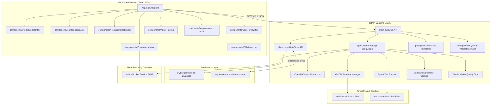

# System Architecture

Provable is an agentic software development simulator. It features a React-based PM Studio frontend and a FastAPI backend that orchestrates autonomous developer agents within a sandboxed target git repository (`workspace/`).

## 1. Subsystem Breakdown

### PM Studio Frontend (`src/`)
Built with React, TypeScript, Vite, and custom CSS styling. It provides project management control over autonomous developer agents:
- **`App.tsx`**: Main application container housing header controls, navigation tabs (Kanban, Requirements Explorer, Code Review, Coverage Hub), and global agent status banners.
- **`components/KanbanBoard.tsx`**: Displays tickets in Kanban lifecycle columns (`Backlog`, `In Progress`, `Review`, `Conflict`, `Done`) with real-time state badges.
- **`components/RequirementsList.tsx`**: Hierarchical tree viewer for folders, requirements, tasks, and bugs. Supports full CRUD operations, parent assignment, dependency management, and TDD test spec generation triggers.
- **`components/CodeReview.tsx`**: Embeds side-by-side git diffs (`DiffViewer`), pytest log tracebacks, and review approval/rejection action buttons.
- **`components/CoverageHub.tsx`**: Aggregates requirement-to-test mapping matrices and embeds the live Allure Docker portal (`:5050`) within an iframe.
- **`components/AgentTray.tsx`**: Collapsible console tray displaying active LangGraph execution nodes, attempt counters, streaming stdout/stderr log output, and review queue items.
- **`components/ProjectSelector.tsx`**: Drawer modal for switching workspace project directories and configuring model provider keys.

### FastAPI Backend Engine (`backend/`)
The core orchestrator and REST service layer:
- **`main.py`**: Exposes endpoints for requirement CRUD, project selection, git diff generation, agent run statuses, and ticket merge approvals. Performs automatic project initialization against the Allure Docker container on startup.
- **`agent_orchestrator.py`**: Executes the autonomous agent state machine using **LangGraph**. Coordinates branch creation, LLM code generation, preview dev server execution, pytest runner, Selenium screenshot capture, Gemini Vision visual layout evaluation, and git rollbacks.
- **`db/store.py`**: High-performance SQLite wrapper (`provable.db`) managing relational data for requirements, test cases, and agent runs.
- **`integrations/`**: Modules for syncing SQLite state with StrictDoc specification files (`strictdoc_client.py`), Jira tickets (`jira_client.py`), and Allure Docker API endpoints (`allure_client.py`).

### Data Storage & Specifications
- **SQLite Database (`backend/provable.db`)**: Primary operational database powering real-time queries.
- **StrictDoc Specs (`requirements/requirements.sdoc`)**: Text-based specification files synchronized bidirectionally with the SQLite database to maintain version-controlled requirements in Git.

### Containerized Infrastructure
- **Allure Docker Service (`frankescobar/allure-docker-service:5050`)**: Containerized reporting service that aggregates pytest execution outputs from `workspace/allure-results/` and renders coverage metrics.
