# System Architecture

Provable is an enterprise-grade, deterministic Domain-Driven Design (DDD) and Test-Driven Development (TDD) AppGen Engine. It features a React-based PM Studio frontend and a FastAPI backend orchestrating a deterministic TDD state machine (`tdd_machine.py`), router engine (`router_engine.py`), instant full-stack skeleton builder (`skeleton_builder.py`), and LibCST surgical code splicing (`cst_isolator.py`).

```mermaid
graph TD
    subgraph Frontend [PM Studio Frontend - React / Vite]
        App[App.tsx Entrypoint] --> ProjectSelector[components/ProjectSelector.tsx]
        App --> Kickstart[components/KickstartStudio.tsx Bounded Context Studio]
        App --> AppPreview[components/AppPreview.tsx 3-View System: Preview / Swagger / Domain]
        App --> BehaviorInbox[components/BehaviorInboxPanel.tsx BDD Spec CRUD]
        App --> ReqControl[components/RequirementControlPanel.tsx Domain Aggregates]
        App --> DomainEntities[components/DomainEntitiesPanel.tsx Dynamic Entity Data]
        App --> CoverageHub[components/CoverageHub.tsx Allure Matrix]
    end

    subgraph Backend [FastAPI Backend Engine]
        API[main.py REST API] --> Store[db/store.py DataStore API]
        API --> RouterEngine[onboarding/router_engine.py Domain Decomposition]
        API --> SkeletonBuilder[onboarding/skeleton_builder.py Instant Full-Stack Skeleton]
        API --> CSTIsolator[onboarding/cst_isolator.py Meta LibCST Splicer]
        API --> TDDMachine[service_layer/tdd_machine.py Red-Gate & Hash-Lock Engine]
        API --> ServiceLayer[service_layer/services.py Use Cases]
        ServiceLayer --> UoW[service_layer/unit_of_work.py Sqlite/Fake UoW]
    end

    subgraph DB [Persistence Layer]
        Store --> SQLite[SQLite provable.db Database]
        Store <-->|Bidirectional Sync| SDoc[requirements/requirements.sdoc]
    end

    subgraph Workspace [Target Project Sandbox]
        SkeletonBuilder --> TargetCode[workspace/src/domain/ Aggregate Roots]
        SkeletonBuilder --> TargetAdapters[workspace/src/adapters/ Repositories]
        SkeletonBuilder --> TargetRouters[workspace/src/entrypoints/routers/ FastAPI Routers]
        TargetRouters --> TargetOpenAPI[FastAPI /openapi.json Contract]
        TargetCode <-->|TDD Machine & Pytest| WorkspaceTests[workspace/tests/unit/]
    end

    subgraph Docker [Allure Reporting Container]
        ServiceLayer --> AllureContainer[Allure Docker Service :5050]
        CoverageHub --> AllureContainer
    end

    App <-->|REST API / JSON| API
```

---

## Subsystem Breakdown

### PM Studio Frontend (`frontend/src/`)
Built with React, TypeScript, Vite, and custom CSS styling across modular views:
- **`App.tsx`**: Top-level layout manager, project banner, and global navigation.
- **`components/KickstartStudio.tsx`**: Bounded context intake studio accepting industrial domain pitches, triggering decomposition and skeleton synthesis, and managing workspace resets (`/api/onboarding/reset`).
- **`components/AppPreview.tsx`**: 3-View Workspace System hosting:
  1. `Preview`: Live sandboxed web preview (`http://localhost:5174/`).
  2. `API (Swagger)`: Embedded FastAPI OpenAPI Swagger interface (`http://localhost:8000/docs`).
  3. `Domain`: Abstract JSON-driven schema visualizer presenting Python Aggregate dataclasses (`Pallet`, `Zone`, `Operator`), attributes, types, invariants, and method signatures.
- **`components/BehaviorInboxPanel.tsx`**: Structured BDD specification inbox for atomic business rules (`GIVEN / WHEN / THEN`), target aggregate binding, and mathematical/boundary flags (triggering Hypothesis).
- **`components/RequirementControlPanel.tsx`**: Domain aggregate tree view with inline BDD test specs, live TDD state badges (`🟢 FULFILLED`, `⚡ TDD RUNNING`, `🔴 NEEDS REVIEW`, `⏳ PENDING`), and dynamic attribute controls.
- **`components/DomainEntitiesPanel.tsx`**: Dynamic entity data fixture viewer and editor bound directly to active schema attributes.
- **`components/CoverageHub.tsx`**: Aggregates requirement-to-test mapping matrices and embeds the live Allure Docker portal (`:5050`).

### FastAPI Backend Engine (`backend/`)
- **`main.py` / `app.py`**: FastAPI application mounting routers for specs, kickstart, onboarding, requirements, components, projects, and testing.
- **`onboarding/router_engine.py`**: Decomposes natural language pitches into `DomainStructureSchema` (Entities/Value Objects) and `DomainBehaviorInboxSchema` (Atomic BDD specs).
- **`onboarding/skeleton_builder.py`**: Scaffolds pure DDD domain models, Abstract/Fake Repositories, Unit of Work, Pydantic DTOs, and FastAPI routers exporting `/openapi.json` from second zero.
- **`onboarding/cst_isolator.py`**: Uses Meta `libcst` to extract and splice Aggregate Root classes with 100% preservation of comments, docstrings, formatting, and surrounding code.
- **`service_layer/tdd_machine.py`**: Red-Gate TDD state machine with programmatic Pytest evaluation, tautology rejection (Exit 0 in RED), syntax/timeout rejection (Exit 2), SHA-256 5-line test integrity hash locking, and 3-strike dead-end rollback handling.
- **`db/store.py`**: SQLite database wrapper (`provable.db`) managing relational data for requirements, test cases, projects, and kickstart states.

---

## 🏛️ Discrepancies & Architectural Evolution

> [!NOTE]
> [DISCREPANCY: Doc approach better - The original doc specified an LLM-driven micro-context repair prompt via LibCST slicing during GREEN_GEN, whereas the current code in tdd_machine.py relies on hardcoded string-matching heuristic stubs (e.g. inject validate_invariants or weight: float). The LLM-driven LibCST repair is architecturally superior and generalizable.]

> [!NOTE]
> [DISCREPANCY: Doc approach better - Pure Runtime Schema-Driven UI via OpenAPI dynamic form generation eliminates frontend LLM hallucinations and maintenance overhead, whereas the codebase still maintains legacy TSX generators.]

---

## 🔗 Related Documentation
- [[Enterprise-AppGen-TDD-Engine-Architecture]]
- [[Universal-Dynamic-Domain-AST-Generator]]
- [[Automated-Verification-And-Self-Healing-Pipeline]]
- [[05-DDD-TDD-Architecture-Guidelines]]
- [[Frontend Components]]
- [[Backend REST API]]

