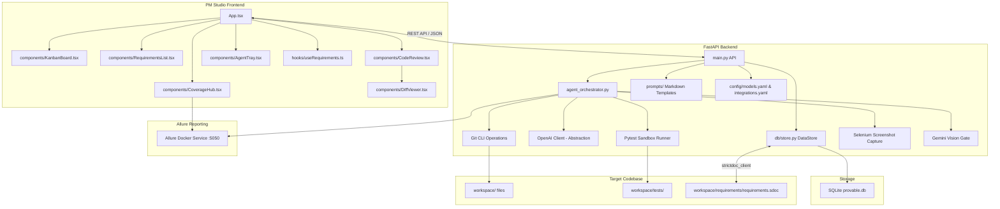

# System Architecture

Provable is an agentic software development simulator. It features a React-based PM Studio frontend and a FastAPI backend that runs and evaluates autonomous coding agents within a sandboxed git repository (`workspace/`).

## 1. PM Studio Frontend (`src/`)
Built with React, TypeScript, and Vite. It is fully modularized:
- **`App.tsx`**: Lightweight entry point managing routing, navigation tabs, and basic layout.
- **`components/KanbanBoard.tsx`**: Displays active tasks in columns: `Backlog`, `In Progress`, `Review`, `Conflict`, and `Done`.
- **`components/RequirementsList.tsx`**: Nested folder hierarchy supporting full CRUD for folders, requirements, tasks, and bugs. Integrates "Create Test Case" triggers that generate failing pytest specs.
- **`components/CodeReview.tsx`**: Displays code submissions from active developer agent branches, embedding the **`DiffViewer`** side-by-side with pytest results.
- **`components/CoverageHub.tsx`**: High-level test summary and coverage analytics embedding the Allure Docker Service live dashboard via an iframe.
- **`components/AgentTray.tsx`**: Collapsible bottom console tray showing active execution steps, attempts, real-time log streaming, and backlog blockers queue.
- **`hooks/useRequirements.ts`**: Encapsulates all query fetching and database mutation hooks for requirements metadata.

## 2. FastAPI Backend (`backend/`)
The engine of the simulator, handling API requests and background agent orchestration:
- **`main.py`**: Exposes endpoints for requirements, settings, git diffs, review lists, agent-status, and ticket merging. Configures an automatic POST hook on startup to register the `provable` project in the Allure container.
- **`agent_orchestrator.py`**: Executes the agent loop. It uses LangGraph to orchestrate coding agents, git commits, test runs, and screenshot evaluation.
- **LLM Abstraction**: Backend routes all LLM queries via the OpenAI Python SDK and configurations in `config/models.yaml`.
- **Externalized Prompts**: System and retry prompts are externalized as markdown templates inside the `backend/prompts/` directory.

## 3. Data Storage
- SQLite Database (`backend/provable.db`) stores all requirements, test cases, and agent runs.
- Initial migrations and fallback syncing utilize `src/requirements.json`.
- Integrations automatically export SQLite records to StrictDoc specs and Jira (when enabled).
