# System Architecture

Provable is an agentic software engineering simulation platform. It features a React-based PM Studio frontend and a FastAPI backend that orchestrates autonomous OpenHands developer agents and dynamic Domain-Driven Design (DDD) application stacks within a sandboxed target git repository (`workspace/`).

```mermaid
graph TD
    subgraph Frontend [PM Studio Frontend - React / Vite]
        App[App.tsx Entrypoint] --> ProjectSelector[components/ProjectSelector.tsx]
        App --> DomainModeling[components/DomainModeling.tsx Discovery Canvas]
        App --> RequirementsList[components/RequirementsList.tsx Explorer]
        App --> AppPreview[components/AppPreview.tsx Live App Preview]
        App --> CodeReview[components/CodeReview.tsx Review Queue]
        App --> CoverageHub[components/CoverageHub.tsx Coverage Matrix]
        App --> AgentTray[components/AgentTray.tsx Console]
        CodeReview --> DiffViewer[components/DiffViewer.tsx]
    end

    subgraph Backend [FastAPI Backend Engine]
        API[main.py REST API] --> Store[db/store.py DataStore API]
        API --> Generator[onboarding/dynamic_domain_generator.py Universal AST Builder]
        API --> Audit[audit_domain_vocabulary Vocabulary Audit Gate]
        API --> HealthGate[verify_preview_health Web App Health Gate]
        API --> Orchestrator[agent_orchestrator.py OpenHands Runner]
        API --> Prompts[prompts/ Externalized Templates]
        Orchestrator --> OpenHands[OpenHands Execution Engine]
        Orchestrator --> Pytest[Pytest Test Runner]
    end

    subgraph DB [Persistence Layer]
        Store --> SQLite[SQLite provable.db Database]
        Store <-->|Bidirectional Sync| SDoc[requirements/requirements.sdoc]
    end

    subgraph Workspace [Target Project Sandbox]
        Generator --> TargetCode[workspace/src/ DDD Source Stack]
        Generator --> TargetUI[workspace/src/App.tsx React App]
        TargetUI <-->|Vite Server :5174| AppPreview
    end

    subgraph Docker [Allure Reporting Container]
        Orchestrator --> AllureContainer[Allure Docker Service :5050]
        CoverageHub --> AllureContainer
    end

    App <-->|REST API / JSON| API
```

---

## Subsystem Breakdown

### PM Studio Frontend (`src/`)
Built with React, TypeScript, Vite, and custom CSS styling across 5 primary tabs:
- **`App.tsx`**: Main application shell housing top navigation tabs (Domain Model, Requirements Explorer, Live App, Code Review, Coverage Hub).
- **`components/DomainModeling.tsx`**: Interactive Domain Storming canvas supporting raw business pitch discovery, pitch-specific UML diagram rendering, 6-part DDD specification review, and 1-click synthesis.
- **`components/AppPreview.tsx`**: Live Web App Preview component embedding the workspace Vite dev server iframe (`http://localhost:5174/`) with dual-port switching, device responsive modes, refresh, and external window popout.
- **`components/RequirementsList.tsx`**: Hierarchical specification tree supporting folders, requirements, tasks, and bugs. Supports CRUD operations, status indicators (`Backlog` vs `Done`), and TDD test spec generation triggers.
- **`components/CodeReview.tsx`**: Renders side-by-side git diffs (`DiffViewer`), pytest log tracebacks, and 1-click Approval (Merge to Main) / Rejection workflows.
- **`components/CoverageHub.tsx`**: Aggregates requirement-to-test mapping matrices and embeds the live Allure Docker portal (`:5050`).
- **`components/AgentTray.tsx`**: Collapsible console tray displaying active execution step, attempt counters, and streaming stdout/stderr log output.

### FastAPI Backend Engine (`backend/`)
- **`main.py`**: Exposes endpoints for domain discovery/synthesis, requirement CRUD, project selection, git diff generation, agent run statuses, and project resets (`reset_database`).
- **`onboarding/dynamic_domain_generator.py`**: Universal Dynamic Domain AST Generator synthesizing pure DDD backend modules (`model.py`, `commands.py`, `events.py`, `orm.py`, `bootstrap.py`, `app.py`) and React UIs (`App.tsx`) for ANY arbitrary domain schema without template leakage.
- **`agent_orchestrator.py`**: Executes the OpenHands agent runner loop (`run_openhands_loop`), managing branch isolation, task prompt formulation, pytest verification, and git rollbacks.
- **`db/store.py`**: SQLite database wrapper (`provable.db`) managing relational data for requirements, test cases, and agent runs.

---

## 🔗 Related Documentation
- [[Universal-Dynamic-Domain-AST-Generator]]
- [[Automated-Verification-And-Self-Healing-Pipeline]]
- [[05-DDD-TDD-Architecture-Guidelines]]
- [[Frontend Components]]
- [[Backend REST API]]
