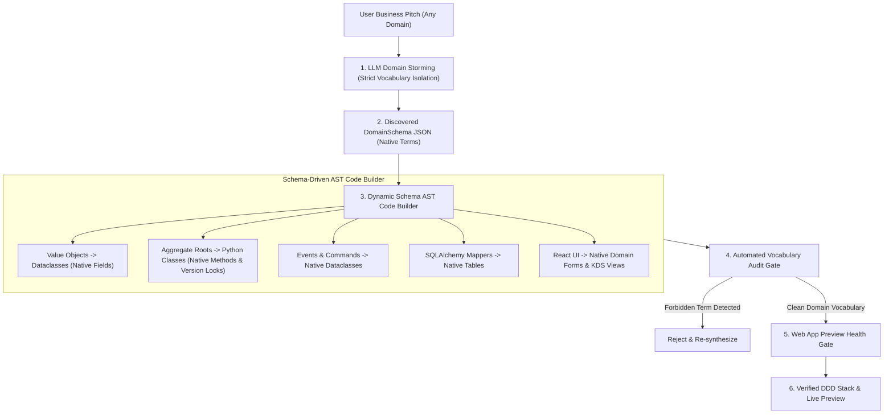

# Universal Dynamic Domain AST Generator

The **Universal Dynamic Domain AST Generator** ([`backend/onboarding/dynamic_domain_generator.py`](file:///c:/Users/ahlst/Documents/GitHub/provable/backend/onboarding/dynamic_domain_generator.py)) is Provable's core engine for transforming arbitrary natural language business pitches into 100% contract-first, clean Domain-Driven Design (DDD) backend modules and React 18 frontend applications.

---

## 🏛️ Key Architectural Features

### 3. Zero Hardcoded Component & Pre-Selected Block Invariant
- **Zero Default Pre-Selected Feature Blocks**: All feature blocks in [`block_catalog.py`](file:///c:/Users/ahlst/Documents/GitHub/provable/backend/onboarding/block_catalog.py) default to `default_selected: False`. Feature topology is 100% pitch-driven.
- **Contract-Driven Modular AST Compilation**: Zero hardcoded mini-games, custom builders, or delivery SLA badges in template strings. Specialized component containers (e.g. `__FLAPPY_HOOKS_JSX__`, `__BUILDER_CONTAINER_JSX__`) are conditionally compiled **ONLY when explicitly present in the site AST active keys**. Non-matching prompts (e.g., `"A chess game"`) compile clean, isolated custom component nodes without template leakage.

---

## 🛡️ Integration with Closed-Loop Verification

Every codebase produced by the generator must pass two automated verification gates in [`backend/main.py`](file:///c:/Users/ahlst/Documents/GitHub/provable/backend/main.py):
1. **[[Automated-Verification-And-Self-Healing-Pipeline|Vocabulary Audit Gate]]**: Verifies 0 forbidden retail terms (`sku`, `batch`, `_purchased_quantity`) in non-retail pitches.
2. **[[Automated-Verification-And-Self-Healing-Pipeline|Web App Preview Health Gate]]**: Executes `npx vite build` (0 JSX errors) and GET HTTP 200 OK reachability on port 5174.

---

## 🔗 Related Documentation
- [[05-DDD-TDD-Architecture-Guidelines]]
- [[Automated-Verification-And-Self-Healing-Pipeline]]
- [[Onboarding and Discovery Workflow]]
- [[Chapter-07-Aggregates-and-Optimistic-Concurrency]]
- [[Chapter-13-Dependency-Injection-and-Bootstrap]]
