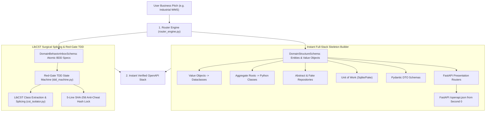

# Universal Dynamic Domain AST Generator & Skeleton Engine

The **Universal Dynamic Domain Generator** comprises the **Router Engine** ([`backend/onboarding/router_engine.py`](file:///c:/Users/ahlst/Documents/GitHub/provable/backend/onboarding/router_engine.py)), **Skeleton Builder** ([`backend/onboarding/skeleton_builder.py`](file:///c:/Users/ahlst/Documents/GitHub/provable/backend/onboarding/skeleton_builder.py)), and **LibCST Isolator** ([`backend/onboarding/cst_isolator.py`](file:///c:/Users/ahlst/Documents/GitHub/provable/backend/onboarding/cst_isolator.py)). It transforms arbitrary natural language business pitches into 100% contract-first, clean Domain-Driven Design (DDD) backend modules and OpenAPI schemas.

---

## 🏛️ Key Architectural Features

### 1. Pure DDD Layer Isolation
- **Domain Layer (`workspace/src/domain/`)**: Pure dataclasses with 0 framework or ORM dependencies.
- **Adapters Layer (`workspace/src/adapters/`)**: Abstract repository definitions and in-memory test doubles (`FakeRepository`).
- **Service Layer (`workspace/src/service_layer/`)**: `AbstractUnitOfWork` and `FakeUnitOfWork` for transaction management.
- **Entrypoints (`workspace/src/entrypoints/`)**: FastAPI routers and Pydantic schemas.

### 2. Surgical LibCST Class Splicing (`cst_isolator.py`)
- Replaces legacy whole-file AST string regeneration with surgical class extraction (`extract_class_cst`) and splicing (`splice_class_cst`) using Meta `libcst`.
- Preserves 100% of formatting, comments, and Google-style docstrings.

---

## 🛡️ Active Generator Architecture

> [!NOTE]
> **Pure LibCST & Skeleton Generator Pipeline**: Legacy monolithic string-template generators (`dynamic_domain_generator.py` and `site_ast_compiler.py`) have been entirely purged. All domain synthesis routes through `skeleton_builder.py` and Meta `cst_isolator.py`.

---

## 🔗 Related Documentation
- [[Enterprise-AppGen-TDD-Engine-Architecture]]
- [[05-DDD-TDD-Architecture-Guidelines]]
- [[Automated-Verification-And-Self-Healing-Pipeline]]
- [[Onboarding and Discovery Workflow]]

