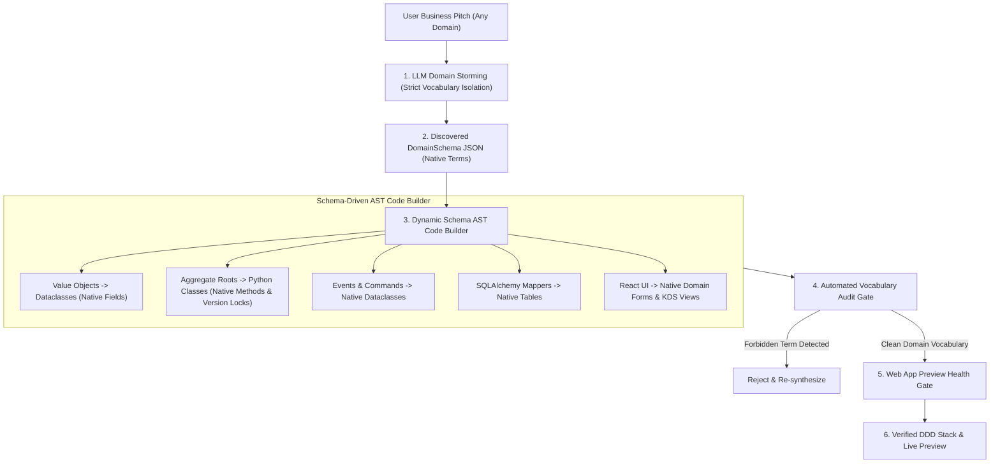

# Universal Dynamic Domain AST Generator

The **Universal Dynamic Domain AST Generator** ([`backend/onboarding/dynamic_domain_generator.py`](file:///c:/Users/ahlst/Documents/GitHub/provable/backend/onboarding/dynamic_domain_generator.py)) is Provable's core engine for transforming arbitrary natural language business pitches into 100% contract-first, clean Domain-Driven Design (DDD) backend modules and React 18 frontend applications.

---

## 🏛️ Key Architectural Features

### 1. Zero Template Leakage & Strict Vocabulary Isolation
Older systems relied on static code string templates containing hardcoded retail terms (`Batch`, `OrderLine`, `sku`, `ref`, `allocate`). The Universal AST Generator completely eliminates template leakage by:
- Enforcing strict negative prompt constraints in [`backend/prompts/domain_discovery.md`](file:///c:/Users/ahlst/Documents/GitHub/provable/backend/prompts/domain_discovery.md):
  > *"CRITICAL INSTRUCTION: You MUST use vocabulary native to the user's business domain (e.g. for Pizzeria: PizzaOrder, OvenStation, OrderItem). You MUST NOT use generic or unrelated terms like 'SKU', 'Batch', 'allocate', or '_purchased_quantity' unless the user's pitch explicitly describes retail stock allocation."*
- Dynamically parsing `DomainSchema` fields, methods, value objects, commands, events, and exceptions to render native Python code.

### 2. Generated 6-Part DDD Backend Architecture

| Module File | Architectural Responsibility | Dynamic AST Generation Details |
| :--- | :--- | :--- |
| **`domain/model.py`** | Pure Domain Aggregate Roots & Value Objects | Renders `@dataclass(frozen=True)` value objects, aggregate root classes with `version_number` locks, and native business methods. |
| **`domain/events.py`** | Domain Events | Renders dataclasses for events emitted during aggregate state transitions (e.g., `OrderPlaced`, `BakingStarted`). |
| **`domain/commands.py`** | Command Objects | Renders dataclasses for user-initiated actions (e.g., `PlacePizzaOrder`, `StartBaking`). |
| **`adapters/orm.py`** | Imperative SQLAlchemy Mappers | Generates SQLAlchemy `Table` definitions, relationship mappers, and DB-enforced optimistic concurrency locks (`version_id_col`). |
| **`src/bootstrap.py`** | Dependency Injection Container | Generates `bootstrap.bootstrap()` container injecting `uow` and `publish` handlers via `inspect.signature`. |
| **`src/App.tsx`** | React 18 Frontend Application | Renders dynamic domain forms for commands and real-time CQRS read view tables. |

---

## 🛡️ Integration with Closed-Loop Verification

Every codebase produced by the generator must pass two automated verification gates in [`backend/main.py`](file:///c:/Users/ahlst/Documents/GitHub/provable/backend/main.py):
1. **[[Automated-Verification-And-Self-Healing-Pipeline|Vocabulary Audit Gate]]**: Verifies 0 forbidden retail terms (`sku`, `batch`, `_purchased_quantity`) in non-retail pitches.
2. **[[Automated-Verification-And-Self-Healing-Pipeline|Web App Preview Health Gate]]**: Executes `npx vite build` (0 JSX errors) and GET HTTP 200 OK reachability on port 5174.

---

## 🔗 Related Documentation
- [[05-DDD-TDD-Architecture-Guidelines]]
- [[Automated-Verification-And-Self-Healing-Pipeline]]
- [[Onboarding and Discovery Workflow]]
- [[Chapter-07-Aggregates-and-Optimistic-Concurrency]]
- [[Chapter-13-Dependency-Injection-and-Bootstrap]]
