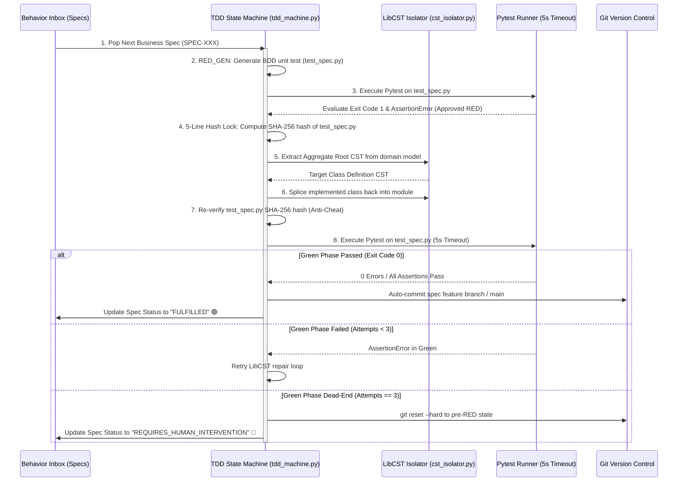

# Deterministic TDD Agent Execution Pipeline

Provable utilizes a **Deterministic TDD State Machine** ([`backend/service_layer/tdd_machine.py`](../../backend/service_layer/tdd_machine.py)) enforcing programmatic Red-Gate evaluation, Meta LibCST code isolation, and SHA-256 test integrity hash locking.

---

## Detailed Execution Steps

### 1. Spec Intake & RED Gate
- Ingests atomic `BusinessSpec` from Behavior Inbox.
- Generates BDD pytest test file (`workspace/tests/unit/test_<spec_id>.py`).
- Executes Pytest with `--timeout=5` and `--json-report`.
- **Programmatic Red-Gate Evaluation (`evaluate_red_gate_result`)**:
  - Exit Code 0 (Pass without code) $\rightarrow$ **REJECTED_TAUTOLOGY**.
  - Before that verdict, the test is run once more against the class with every method emptied out (`service_layer/hollow_check.py`, on a temporary copy of the sources). If it fails there, it does test behaviour and the class already has it (the action stage writes the methods before the rule deck runs): the spec is `FULFILLED` with `already_satisfied`, no code is generated, and the test stays in `tests/unit` as the rule's regression guard. If it passes there too, it asserts nothing and is a tautology.
  - Exit Code 2 / SyntaxError / Timeout $\rightarrow$ **REJECTED_SYNTAX_OR_EXEC**.
  - Exit Code 1 with `AssertionError` $\rightarrow$ **APPROVED_RED**.

### 2. 5-Line SHA-256 Hash Lock Anti-Cheat
- Computes SHA-256 hash snapshot of `test_<spec_id>.py`.
- Enforces that no test assertion or file content is tampered with during code generation.

### 3. LibCST Surgical Class Splicing (`cst_isolator.py`)
- Extracts the exact class CST node from the domain module.
- Generates or updates domain methods and invariants.
- Splices updated class back into the module preserving 100% of formatting, comments, and docstrings.

### 4. GREEN Gate & Commit / Rollback
- Re-verifies test file SHA-256 hash (`verify_test_file_integrity`).
- Executes Pytest. If Exit Code 0: marks spec `FULFILLED` and commits.
- If failed after 3 attempts: executes `git reset --hard` to pre-RED state and flags `REQUIRES_HUMAN_INTERVENTION`.

---

## 🏛️ Discrepancies & Evolution Tags

> [!NOTE]
> [DISCREPANCY: Doc approach better - The original execution loop specification was designed for autonomous LLM code generation iterating over full repo branches. While tdd_machine.py successfully isolates the RED-GREEN-COMMIT loop, the GREEN implementation currently relies on stub mutations rather than live LLM-driven LibCST prompts. Connecting the LLM to the LibCST micro-context is architecturally superior.]

---

## 🔗 Related Documentation
- [[Enterprise-AppGen-TDD-Engine-Architecture]]
- [[System Architecture]]
- [[DDD_TDD_Developer_Workflow]]

