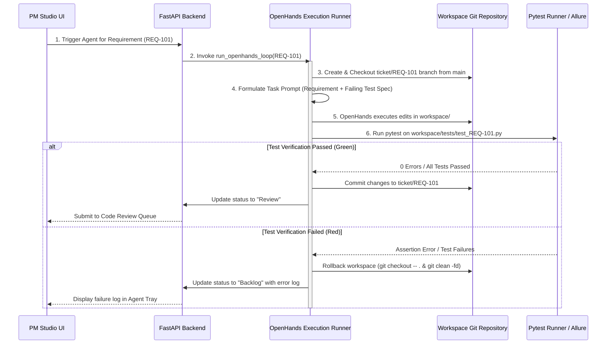

# OpenHands Agent Execution Pipeline

Provable utilizes an **OpenHands Agent Execution Runner** (`backend/agent_orchestrator.py`) to execute developer tasks inside target workspaces (`workspace/`).

## Detailed Execution Steps

### 1. Task Selection & Initialization
- `run_openhands_loop(req_id)` identifies the target `Backlog` item.
- Initializes agent status tracking and creates log stream at `backend/logs/<TICKET_ID>.log`.

### 2. Git Branch Isolation
- Checks out `main` and creates/resets dedicated working branch `ticket/<TICKET_ID>`.

### 3. OpenHands Task Prompt Assembly
- Formulates the task prompt containing requirement title, detailed description, and path to target BDD pytest spec (`workspace/tests/test_<REQ_ID>.py`).

### 4. Sandbox Execution
- OpenHands runs inside the target workspace directory (`workspace/`), performing code modifications to satisfy the failing test spec.

### 5. Verification & Review Queue Finalization
- Executes `run_pytest()` on the target test spec.
- On **PASS**: Commits branch `ticket/<TICKET_ID>` and transitions ticket to `Review` status for PM git diff inspection and 1-click merge approval.
- On **FAIL**: Cleans up workspace (`git checkout -- .`, `git clean -fd`) and records failure logs in DataStore.
