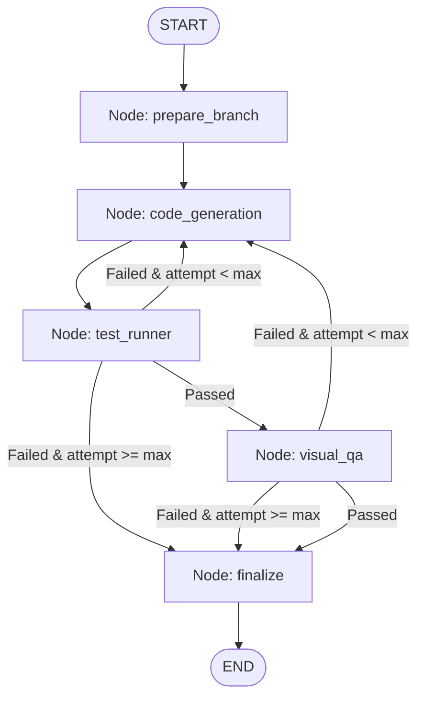

# Agent Execution Loop & LangGraph State Machine

Provable orchestrates autonomous coding agents using a StateGraph state machine implemented via **LangGraph**. The orchestrator manages branch checkout, code generation, preview serving, pytest execution, Allure reporting uploads, selenium screenshot captures, visual layout validations, and clean git rollback controls.



---

## AgentState TypedDict Schema

To deterministically recreate the LangGraph orchestrator state, implement this TypedDict:

```python
from typing import TypedDict, List, Dict, Optional

class AgentState(TypedDict):
    ticket_id: str
    requirement_id: str
    requirement: Dict
    attempts: int
    max_attempts: int
    branch_name: str
    proposed_code: str
    test_results: Dict
    visual_results: Dict
    error_feedback: str
    logs: List[str]
    status: str  # "running" | "success" | "failed"
```

---

## LangGraph Node Handlers & Routing Rules

```python
# Node 1: Prepare Branch
def prepare_branch_node(state: AgentState) -> AgentState: ...

# Node 2: Code Generation
def code_generation_node(state: AgentState) -> AgentState: ...

# Node 3: Test Runner & Allure Upload
def test_runner_node(state: AgentState) -> AgentState: ...

# Node 4: Visual QA & Vision Layout Gate
def visual_qa_node(state: AgentState) -> AgentState: ...

# Node 5: Finalize & Git Rollback / Commit Staging
def finalize_node(state: AgentState) -> AgentState: ...

# Conditional Edge Routing
def route_after_test(state: AgentState) -> str:
    if state["test_results"].get("passed", False):
        return "visual_qa"
    elif state["attempts"] < state["max_attempts"]:
        return "code_generation"
    else:
        return "finalize"

def route_after_visual(state: AgentState) -> str:
    if state["visual_results"].get("passed", False):
        return "finalize"
    elif state["attempts"] < state["max_attempts"]:
        return "code_generation"
    else:
        return "finalize"
```
