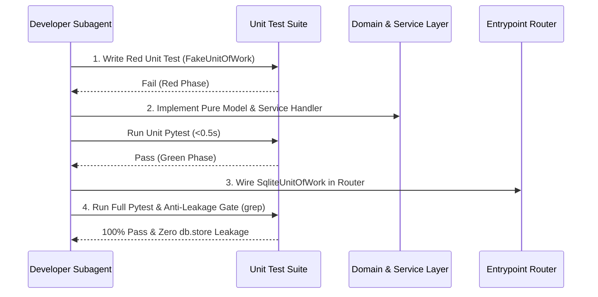

# DDD/TDD Developer Subagent Workflow & Layer Rules

This document outlines the strict execution protocol for the `ddd_tdd_developer` subagent and human developers refactoring or adding backend features in Provable.

---

## 🏛️ Architectural Layer Boundaries

1. **Domain Model Layer** ([`backend/domain/`](../../backend/domain)):
   - Contains pure Python dataclasses (`Requirement`, `Component`, `Project`, `AgentRun`) and custom business domain exceptions (`InvalidStatusTransition`).
   - **Rule**: ZERO imports from FastAPI, Pydantic, SQLAlchemy, or SQLite.
2. **Adapter Layer** ([`backend/adapters/`](../../backend/adapters)):
   - Defines `AbstractRepository` interfaces with concrete implementations (`SqliteRepository`) and fast in-memory fakes (`FakeRepository`).
3. **Service Layer & Unit of Work** ([`backend/service_layer/`](../../backend/service_layer)):
   - Defines `AbstractUnitOfWork`, `SqliteUnitOfWork`, and `FakeUnitOfWork` context managers managing transaction atomicity (`commit()`, `rollback()`).
   - Houses stateless use-case workflows (`create_requirement`, `list_requirements`, `get_requirement`).
4. **Presentation Entrypoints** ([`backend/entrypoints/routers/`](../../backend/entrypoints/routers)):
   - Modular FastAPI routers.
   - **Rule**: MUST NEVER import `db.store` directly. Every POST/GET handler delegates to `services.<use_case>(uow=SqliteUnitOfWork())`.

---

## 🔄 Mandatory 4-Step TDD Execution Loop



---

## 🛡️ Anti-Leakage Verification Gate

At the conclusion of any router or service layer refactoring task, run:
```powershell
grep -rn "import db.store" backend/entrypoints/routers/ backend/service_layer/services.py
```
**Required Result**: `0 matches`.
