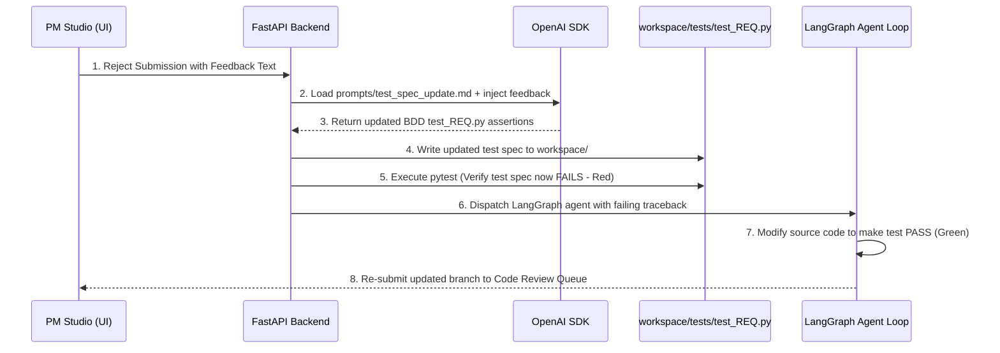

# Future Enhancements & Prototype Roadmap

This document captures all planned, scoped, but unexecuted architectural enhancements to advance Provable towards a production-grade enterprise platform.

---

## 1. ⚡ Live Agent Execution Graph Visualizer

### Overview
Enhance the bottom collapsible `AgentTray.tsx` component with an interactive, animated step graph representing the 5 LangGraph orchestrator nodes:
```
[ prepare_branch ] ➔ [ code_generation ] ➔ [ test_runner ] ➔ [ visual_qa ] ➔ [ finalize ]
```

### Technical Blueprint
- **Data Source**: Poll `/api/agent-status` or connect via Server-Sent Events (SSE).
- **UI Component**: React Flow or custom SVG node graph in [`src/components/AgentTray.tsx`](file:///c:/Users/ahlst/Documents/GitHub/provable/src/components/AgentTray.tsx).
- **Node Log Filtering**: Clicking a node filters the log viewer specifically to that node's execution phase.

---

## 2. 🔄 Self-Healing TDD Feedback Loop

### Overview
When a Project Manager rejects an agent submission in `CodeReview.tsx` with feedback (e.g., *"The export button must be disabled when no rows are selected"*), the system automatically updates the underlying BDD test specification before re-dispatching the developer agent.



---

## 3. 🧪 Multi-Domain Synthesis Benchmark Suite & Stress Tester

### Overview
An automated testing framework (`backend/tests/benchmark_domain_stormer.py`) that runs stress tests across 10 diverse business domain pitches to ensure 100% domain vocabulary isolation and zero Vite build errors.

### Target Domains for Benchmark Suite:
1. **Medical Clinic**: `Appointment`, `Doctor`, `Patient`, `TimeSlot`
2. **Laundromat Service**: `WasherMachine`, `LaundryOrder`, `Cycle`, `Detergent`
3. **Barber Shop**: `Barber`, `HaircutBooking`, `ServiceMenu`
4. **Car Rental Fleet**: `RentalVehicle`, `CustomerBooking`, `ReturnInspection`
5. **SaaS Billing**: `SubscriptionPlan`, `CustomerAccount`, `Invoice`
6. **Construction Logistics**: `HeavyEquipment`, `SiteDispatch`, `Maintenance`
7. **Hotel Reservation**: `GuestRoom`, `Reservation`, `CheckIn`
8. **Gym Membership**: `MemberCard`, `AccessGate`, `ClassBooking`
9. **Restaurant Kitchen**: `KitchenOrder`, `ChefStation`, `TableReservation`
10. **E-Commerce Fulfillment**: `FulfillmentOrder`, `PackingStation`, `Courier`

### Automated Checks Performed by Benchmark Suite:
- **Vocabulary Isolation Audit**: Verifies 0 occurrences of `sku`, `batch`, `_purchased_quantity`, or `OrderLine` in non-retail code output.
- **Syntactic AST Correctness**: Executes `python -m py_compile` on all generated `.py` files.
- **Frontend Build Gate**: Executes `npx vite build` to guarantee zero JSX/TypeScript errors.

---

## 4. 🎨 Interactive Bounded Context & Subdomain Canvas

### Overview
Extend [`src/components/DomainModeling.tsx`](file:///c:/Users/ahlst/Documents/GitHub/provable/src/components/DomainModeling.tsx) with a visual Bounded Context Map visualizer.

### Key Features
- **Bounded Context Boundaries**: Visualizes strategic DDD context boundaries (e.g. `Ordering Context` $\leftrightarrow$ `Kitchen Dispatch Context` $\leftrightarrow$ `Delivery Context`).
- **Context Maps**: Displays upstream/downstream relationship patterns (Customer/Supplier, Shared Kernel, Anti-Corruption Layer).
- **Subdomain Classification**: Categorizes domain components into Core Subdomains, Supporting Subdomains, and Generic Subdomains.

---

## 5. 📄 StrictDoc Bidirectional Webhook Synchronization

### Overview
Automate bidirectional synchronization between SQLite `provable.db` database records and Git version-controlled `.sdoc` specification files (`workspace/requirements/requirements.sdoc`).

### Key Features
- **Automatic Export Hook**: Any REST API call modifying requirements or test cases automatically triggers `strictdoc_client.export_sdoc()`.
- **File Watcher Import Hook**: Modifying `requirements.sdoc` directly in VS Code automatically triggers `strictdoc_client.import_sdoc()` to update SQLite DataStore tables.

---

## 🔗 Related Documentation
- [[System Architecture]]
- [[Universal-Dynamic-Domain-AST-Generator]]
- [[Automated-Verification-And-Self-Healing-Pipeline]]
