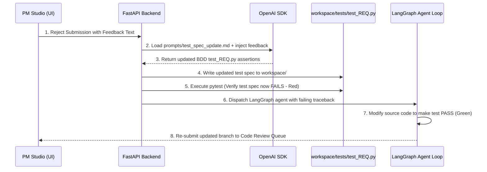
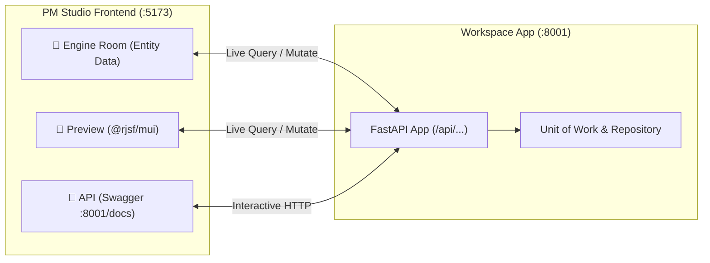
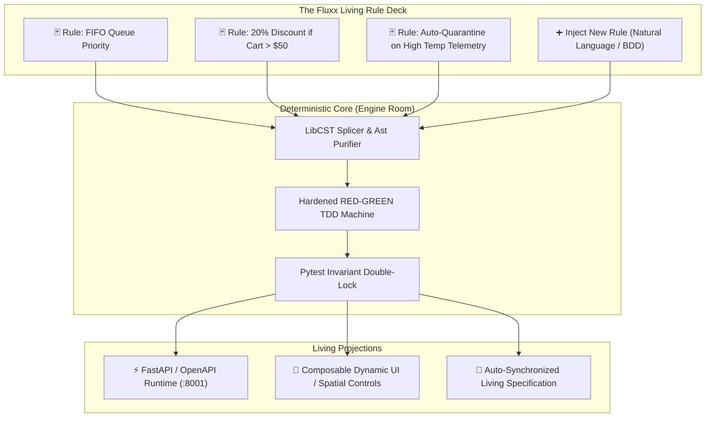
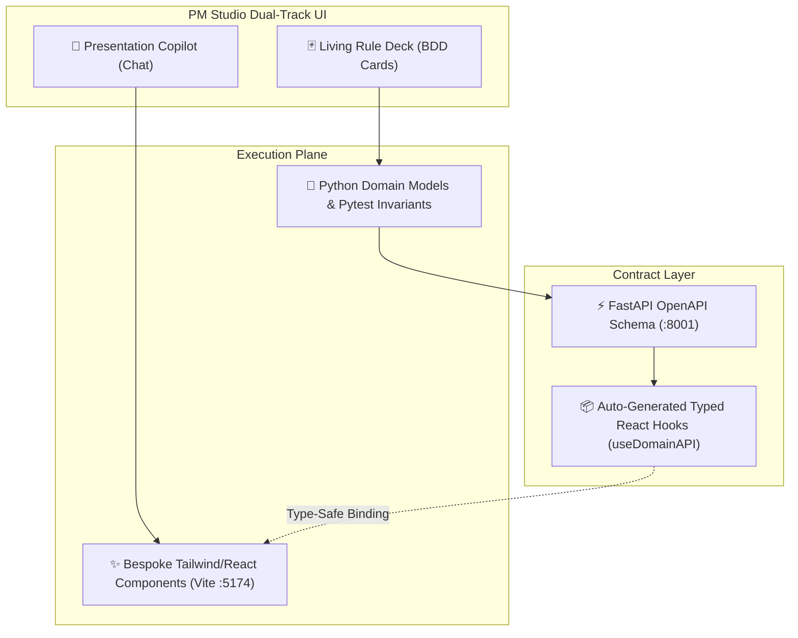
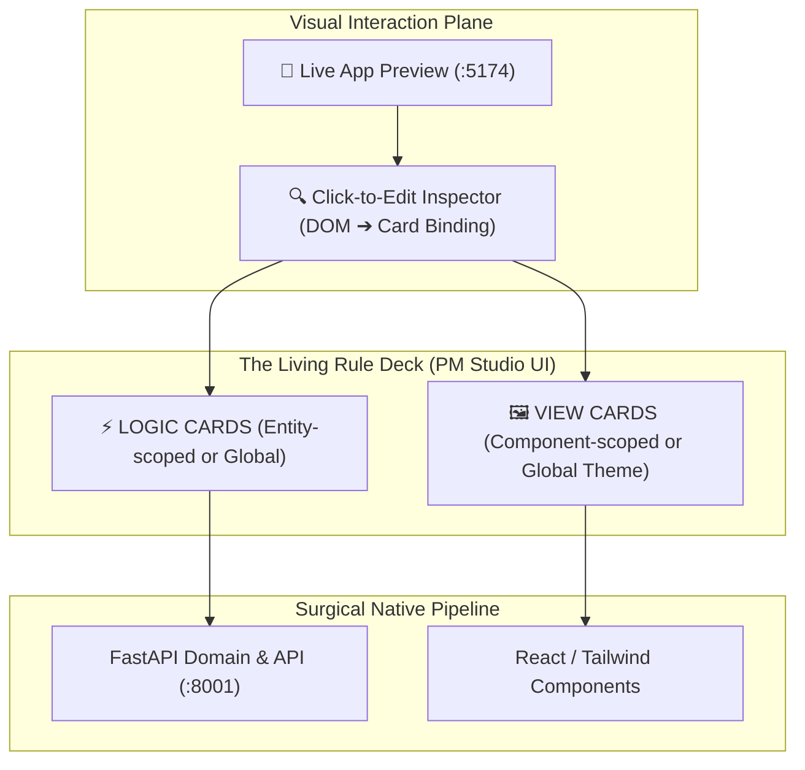
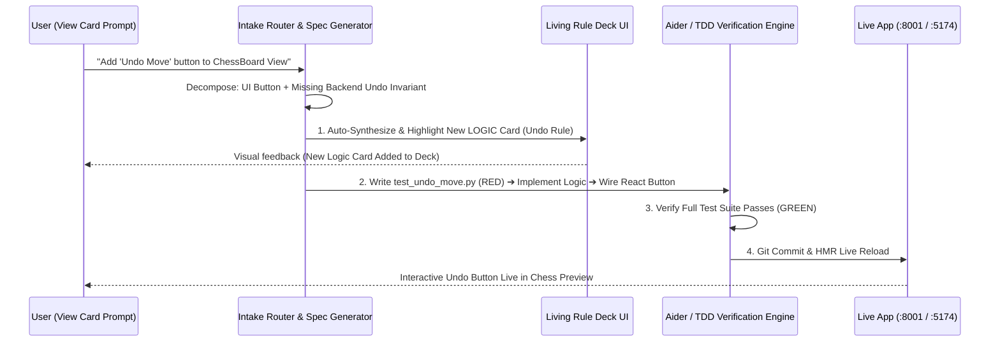
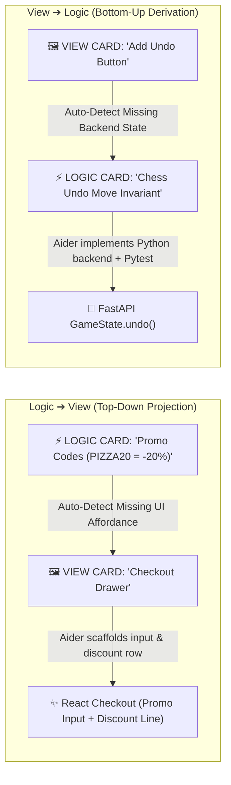
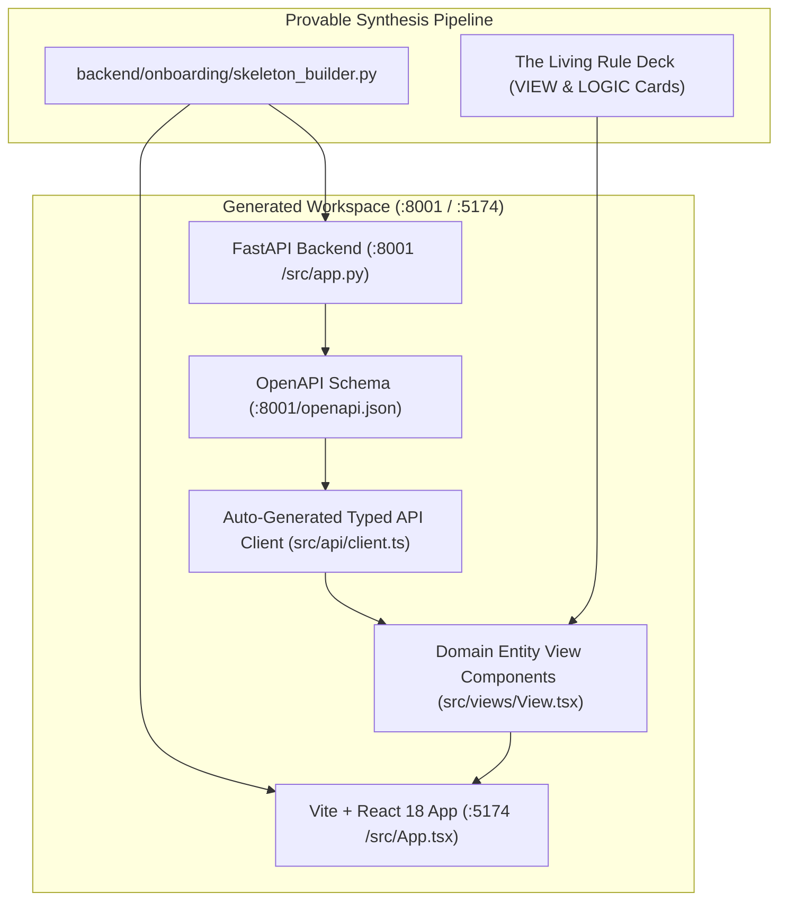

# Future Enhancements & Prototype Roadmap

This document captures all planned, scoped, but unexecuted architectural enhancements to advance Provable towards a production-grade enterprise platform.

---

## 1. ⚡ Live Agent Execution Graph Visualizer

### Overview
Enhance the bottom collapsible `AgentTray.tsx` component with an interactive, animated step graph representing the 5 LangGraph orchestrator nodes:
```
[ prepare_branch ] ➔ [ code_generation ] ➔ [ test_runner ] ➔ [ visual_qa ] ➔ [ finalize ]
```

### Technical Blueprint
- **Data Source**: Poll `/api/agent-status` or connect via Server-Sent Events (SSE).
- **UI Component**: React Flow or custom SVG node graph in `src/components/AgentTray.tsx`.
- **Node Log Filtering**: Clicking a node filters the log viewer specifically to that node's execution phase.

---

## 2. 🔄 Self-Healing TDD Feedback Loop

### Overview
When a Project Manager rejects an agent submission in `CodeReview.tsx` with feedback (e.g., *"The export button must be disabled when no rows are selected"*), the system automatically updates the underlying BDD test specification before re-dispatching the developer agent.



---

## 3. 🧪 Multi-Domain Synthesis Benchmark Suite & Stress Tester

### Overview
An automated testing framework (`backend/tests/benchmark_domain_stormer.py`) that runs stress tests across 10 diverse business domain pitches to ensure 100% domain vocabulary isolation and zero Vite build errors.

### Target Domains for Benchmark Suite:
1. **Medical Clinic**: `Appointment`, `Doctor`, `Patient`, `TimeSlot`
2. **Laundromat Service**: `WasherMachine`, `LaundryOrder`, `Cycle`, `Detergent`
3. **Barber Shop**: `Barber`, `HaircutBooking`, `ServiceMenu`
4. **Car Rental Fleet**: `RentalVehicle`, `CustomerBooking`, `ReturnInspection`
5. **SaaS Billing**: `SubscriptionPlan`, `CustomerAccount`, `Invoice`
6. **Construction Logistics**: `HeavyEquipment`, `SiteDispatch`, `Maintenance`
7. **Hotel Reservation**: `GuestRoom`, `Reservation`, `CheckIn`
8. **Gym Membership**: `MemberCard`, `AccessGate`, `ClassBooking`
9. **Restaurant Kitchen**: `KitchenOrder`, `ChefStation`, `TableReservation`
10. **E-Commerce Fulfillment**: `FulfillmentOrder`, `PackingStation`, `Courier`

### Automated Checks Performed by Benchmark Suite:
- **Vocabulary Isolation Audit**: Verifies 0 occurrences of `sku`, `batch`, `_purchased_quantity`, or `OrderLine` in non-retail code output.
- **Syntactic AST Correctness**: Executes `python -m py_compile` on all generated `.py` files.
- **Frontend Build Gate**: Executes `npx vite build` to guarantee zero JSX/TypeScript errors.

---

## 4. 🎨 Interactive Bounded Context & Subdomain Canvas

### Overview
Extend `src/components/DomainModeling.tsx` with a visual Bounded Context Map visualizer.

### Key Features
- **Bounded Context Boundaries**: Visualizes strategic DDD context boundaries (e.g. `Ordering Context` $\leftrightarrow$ `Kitchen Dispatch Context` $\leftrightarrow$ `Delivery Context`).
- **Context Maps**: Displays upstream/downstream relationship patterns (Customer/Supplier, Shared Kernel, Anti-Corruption Layer).
- **Subdomain Classification**: Categorizes domain components into Core Subdomains, Supporting Subdomains, and Generic Subdomains.

---

## 5. 📄 StrictDoc Bidirectional Webhook Synchronization

### Overview
Automate bidirectional synchronization between SQLite `provable.db` database records and Git version-controlled `.sdoc` specification files (`workspace/requirements/requirements.sdoc`).

### Key Features
- **Automatic Export Hook**: Any REST API call modifying requirements or test cases automatically triggers `strictdoc_client.export_sdoc()`.
- **File Watcher Import Hook**: Modifying `requirements.sdoc` directly in VS Code automatically triggers `strictdoc_client.import_sdoc()` to update SQLite DataStore tables.

---


## 6. 🥊 Boss Fight Acceptance Test Suite: Hazardous Pallet Concurrency & Optimistic Concurrency Control (OCC)

### Overview
A stress-test acceptance suite (`backend/tests/boss_fights/test_hazardous_concurrency.py`) that feeds complex industrial DDD prompts through the full Provable pipeline (OCC versioning, stale data collisions, domain event recording vs direct dispatch) and performs multi-tiered deterministic verification combined with an LLM-as-a-Judge code audit.

### Test Architecture Blueprint:
1. **Isolated Workspace Execution**: Runs synthesis inside a sandboxed `tmp_path` workspace via `PROVABLE_WORKSPACE` override to prevent polluting root `workspace/`.
2. **Deterministic Dynamic Execution Gate (Zero Trust / Anti-Magic)**:
   - **AST Layer Purity**: Programmatically checks `workspace/src/domain/zone.py` and `pallet.py` to ensure zero message bus / I/O imports in the domain layer.
   - **Dynamic Concurrency Collision Execution**: Imports synthesized `Zone` and `Pallet` classes dynamically in Python, executes hazardous pallet quarantine, verifies `version_number` increment, asserts `ZoneQuarantinedEvent` is in `zone.events`, and triggers an actual version collision to assert `StaleDataError` is raised (failing immediately on `NameError` if unimported).
3. **Hardened Zero-Tolerance LLM-as-a-Judge**:
   - Prompts Gemini under a **Binary Disqualification Contract**: if any symbol/exception is undefined or resolved via `globals().get()` hacks, `passed` MUST be `False` and score 0.
4. **Pytest Harness Integration**: Gated by `@pytest.mark.boss_fight` and `pytest.mark.skipif(not os.environ.get("RUN_BOSS_FIGHTS"))` with explicit unpatching of `conftest.py`'s autouse LLM mock.


---

## 7. 🧠 Agent Harness & DevEx Loops: Claude Code Pattern with High-Signal BDD Context

### Overview
Integrate a dual-layer agent architecture:
1. **Developer Experience (DevEx) Skills (`.claude/skills/`)**: Modular interactive tools (e.g. `/grill-me`, `/to-spec`, `/bdd-loop`) inspired by Matt Pocock, used during pair-programming to challenge requirements and generate crystal-clear BDD specs.
2. **Runtime Agent Execution Engine (`backend/service_layer/tdd_machine.py`)**: A Claude Code-style agentic workflow where the LLM is given full problem-solving autonomy within a sandboxed, high-signal micro-context (BDD spec + failing test traceback + domain aggregate), while the deterministic test runner acts as the objective evaluator-optimizer gate.

### Key Capabilities:
- **Zero Context Rot**: Pruned micro-context prompts (avoiding bloated 100k repository context dumps) by leveraging atomic BDD specs.
- **Agentic Freedom with Hard Guardrails**: The LLM writes creative domain logic, while `pytest` and `LibCST` enforce pass/fail contracts and code integrity without micro-managing syntax.
- **Interactive DevEx Skills**: Portable skills for instant requirement interrogation, test generation, and verification loops.

---

## 8. 🥊 Boss Fight 2: The Multi-Stage Iterative Evolution Engine (Realistic Human-Driven DevEx)

### Overview
A multi-stage acceptance stress-test (`backend/tests/boss_fights/test_iterative_domain_evolution.py`) that replicates the true, iterative journey of real-world software engineering rather than expecting a dense, monolithic initial prompt:
1. **Stage 1 (Vague Kickstart & Opinionated Defaults)**: An intentionally minimal 1-2 sentence human pitch (e.g. *"Heavy machinery rental fleet with GPS telemetry tracking and service maintenance lockouts"*). The engine synthesizes robust, working core aggregates (`HeavyEquipment`, `RentalBooking`, `MaintenanceSchedule`) with sensible defaults and passing baseline tests, completely eliminating analysis paralysis.
2. **Stage 2 (Incremental BDD Invariant Injection)**: User injects an incremental feature: *"If machine operating hours exceed 500 hours since last maintenance, lock the machine from new bookings and record a MaintenanceRequiredEvent"*. The TDD State Machine ingests the new BDD spec, generates the failing test (Red), modifies the aggregate, and achieves Green without breaking baseline rentals.
3. **Stage 3 (Complex Concurrency & Race Condition Gate)**: User injects a concurrency invariant: *"Simultaneous bookings on the same equipment must reject the stale request with DoubleBookingError"*. Dynamic Python execution simulates racing threads, verifies OCC version checks, and audits AST purity + zero-tolerance LLM-as-a-Judge.

---

## 9. 🎛️ Dual-Mode Kickstart Engine: Quick Launch (0–3 Questions) vs Guided Co-Design (Max 5 Questions)

### Overview
Enhance `frontend/src/components/KickstartStudio.tsx` and `backend/onboarding/domain_ontology.py` with a dual-mode launch selector giving users full agency over synthesis depth while strictly capping question fatigue:
1. **Mode A: ⚡ Quick Launch (Snabbläge)**:
   - **Target**: 0 questions for 99% of normal prompts.
   - **Mechanism**: Automatically applies all standard opinionated DDD defaults (OCC, Domain Events, Standard State Flow) and immediately synthesizes the baseline prototype. ONLY prompts the user if there is a critical architectural ambiguity where defaults cannot be inferred and synthesis would be blocked.
2. **Mode B: 🎯 Guided Co-Design (Guidad Syntes)**:
   - **Target**: Max 5 strategic domain-fork questions (lifecycle transitions, concurrency strategies, domain event policies).
   - **Mechanism**: Renders interactive selectable chips in the UI allowing the architect to inspect, override, or fine-tune architectural defaults before synthesis.

### Schema Contract:
```python
@dataclass
class ClarificationQuestion:
    id: str
    question: str
    options: List[str]
    default_choice: str
    impact_rationale: str
```

---

## 10. 🏨 Interactive End-to-End Domain Acceptance Playbook (Hotel Room Booking & Housekeeping Lockout)

### Overview
A human-executable, intuitive manual acceptance testing scenario for verifying Provable's end-to-end capabilities in an everyday domain (Hotel Room Booking & Housekeeping Management), mirroring the full architectural complexity of Boss Fight 2 (state machines, optimistic concurrency control, domain event dispatch, and incremental BDD invariant injection).

### Verification Journey:
1. **Kickstart Baseline (Phase 1)**: Launch boutique hotel booking domain (`Room`, `Reservation`, `Guest`) via PM Studio Kickstart Studio.
2. **Dynamic Schema Inspection (Phase 2)**: Validate OpenAPI schema and live `@rjsf/mui` projection in workspace preview (:8001 / :5173).
3. **Incremental Invariant Injection (Phase 3)**: Inject BDD maintenance rule (*"Rooms marked as DIRTY or under maintenance cannot be booked, raising RoomNotReadyError and appending RoomMaintenanceAlertEvent to room.events"*).
4. **OCC Double-Booking Gate (Phase 4)**: Verify version collision handling on concurrent booking attempts.
5. **Interactive Swagger & Live UI Verification (Phase 5)**: Test API endpoints in Swagger (`:8001/docs`) and dynamic preview table in PM Studio.

### Diagnostic Failures & Remediation Plan:
1. **Dynamic RED Test Synthesis (`backend/service_layer/tdd_machine.py`)**: Replace hardcoded `if "500"` fallback templates with dynamic LLM BDD test synthesis so any user-entered GIVEN/WHEN/THEN generates a failing non-tautological test.
2. **DomainEvent Kwarg Flexibility (`backend/onboarding/skeleton_builder.py` & `tdd_machine.py`)**: Ensure `DomainEvent` base class accepts arbitrary `**kwargs` so auto-synchronized events never raise `TypeError`.
3. **Workspace API Lifecycle & Swagger Iframe Health (`backend/run.py` & `AppPreview.tsx`)**: Ensure port 8001 starts reliably and displays connection status/fallback in PM Studio when loading.
4. **Interactive BDD Spec Execution (`RequirementControlPanel.tsx` & `specs.py`)**: Add `▶ Run TDD` action buttons to all pending inbox spec cards to allow executing backlog specs directly from the UI.
5. **Fast Mode Zero-Fatigue Clarification (`KickstartStudio.tsx`)**: Ensure Fast mode launches immediately without redundant questions when the prompt is descriptive.

---

## 11. ⚡ Live Full-Stack Preview Integration (Wiring SchemaDrivenAppPreview to Workspace Domain API on Port 8001)

### Overview
Upgrade `frontend/src/components/SchemaDrivenAppPreview.tsx` from disconnected local React mock state to a true live full-stack client communicating directly with the Workspace Domain API (`http://localhost:8001/api/{slug}`).

### Key Capabilities:
- **Live Bidirectional Fetch & Sync**: Automatically fetches live entity records via `GET http://localhost:8001/api/{slug}` and updates table rows in real-time.
- **Real Backend Mutation**: Submitting forms in Preview triggers `POST http://localhost:8001/api/{slug}`, executing the actual domain models and Unit of Work on port 8001.
- **Visual Domain Invariant Feedback**: When an invariant fails (e.g. booking a `DIRTY` room), displays the real backend HTTP 400/422 domain exception directly in the UI.
- **Swagger / Preview Synchronization**: Changes made in Swagger UI immediately reflect in the Preview table and vice-versa.

---

## 12. 🔄 The Trinity Live Data Continuity Protocol (Engine Room ⇄ Preview ⇄ Swagger API)

### Overview
Establish full runtime data continuity across the three primary views of PM Studio by establishing the running **Workspace Domain API (`http://localhost:8001`)** as the single authoritative source of truth for entity data.



### Architectural Principles:
1. **Single Source of Truth (`:8001`)**: All entity read/write operations in PM Studio target the active workspace endpoints (`/api/rooms`, `/api/bookings`, `/api/guests`).
2. **Auto Tab Invalidation & Live Refresh**: Whenever switching between *Engine Room*, *Preview*, and *API (Swagger)*, the active data views automatically re-sync with the workspace API.
3. **Domain Invariant Feedback**: Domain exceptions raised during Swagger or Preview mutations (e.g. `RoomNotReadyError`, `InvalidStayPeriodError`) are surfaced uniformly in the UI with explicit rule citations.

---

## 13. 🃏 The "Fluxx" Living Invariant Deck & Dynamic Rule Projection Paradigm

### Overview
Elevate Provable from an isolated DDD/FastAPI code generator into a venture-grade **Rule-First Living Application Platform** ("The Fluxx Paradigm"). Rather than forcing users to manipulate raw code or inspect sterile admin forms, the application is defined, evolved, and verified as a living deck of modular **Rules & Invariants** that can be dynamically added, toggled, and verified against a running system.



### Core Value Pillars for VC / Product-Market Fit:
1. **The Post-Vibecoding Solution**: Solves the "80% Wall" of Lovable/v0 by decoupling intent/invariants from volatile code syntax. Users edit business rules ("cards"), while the deterministic engine guarantees zero regressions.
2. **Unified Specification, Test Suite & Documentation**: Unifies requirements, BDD test suites, and system documentation into a single living entity, eliminating context rot and specification drift across long agent sessions.
3. **Explicit Conflict Arbitration (Turning Hidden Bugs into Product Decisions)**: When two rules clash, the deterministic test suite catches the collision immediately at design-time, prompting the user with an explicit priority choice instead of burying a silent runtime failure in code.
4. **Bi-Directional AST Rule Lifecycle**: Supports not just append-only generation, but full rule modification and deactivation via LibCST splicing, allowing cards to be toggled on/off like game rules in Fluxx.
5. **Architectural Control Plane over Raw LLM Agents**: Positions Provable as the high-level steering cockpit that can wrap and orchestrate underlying coding agents (Claude Code, Gemini, etc.) within strict deterministic guardrails.

---

## 14. ⚡ The Surgical Native Fullstack Pipeline (Micro-Context CST & JSX Orchestrator)

### Overview
Rather than relying on heavy, non-deterministic external CLI subprocesses (e.g. Aider) which inflate token costs by 15x–30x per turn and introduce fragile search-replace parsing, Provable utilizes a **Surgical Native Micro-Context Pipeline**. By passing only isolated AST slices for backend classes (`cst_isolator.py`) and single-component JSX templates for frontend views, the engine achieves multi-file fullstack synthesis in **<3 seconds** at **<2,500 tokens** per card (a 90%+ cost reduction).

```mermaid
graph TD
    UI["🃏 Living Rule Deck (PM Studio UI)"] -->|Add / Mutate Card| CP["🧠 Provable Control Plane"]
    
    subgraph "Surgical Backend Phase (CST Micro-Context)"
        CP -->|1. Generate BDD Test| TEST["tests/test_SPEC.py (Write-Locked)"]
        CP -->|2. Micro-AST + Pytest Traceback (~800 tokens)| LLM1["Gemini 3.7 Flash"]
        LLM1 -->|3. LibCST Splicer| DOMAIN["workspace/src/domain/<entity>.py"]
        DOMAIN -->|4. Pytest Invariant Gate| VERIFY["⚡ Pytest Verification"]
    end

    subgraph "Surgical Frontend Phase (JSX Micro-Context)"
        VERIFY -->|5. Pass / Contract Update| OPENAPI["FastAPI /openapi.json"]
        OPENAPI -->|6. Micro-JSX + Typed Hooks (~1,000 tokens)| LLM2["Gemini 3.7 Flash"]
        LLM2 -->|7. Targeted Component Splicer| REACT["workspace/src/components/<View>.tsx"]
    end

    REACT -->|8. HMR Reload| APP["🔮 Live App Preview (:5174)"]
```

### Key Economic & Architectural Advantages:
1. **90%+ Token Cost Reduction**: Eliminates massive whole-repo context dumps; keeps typical turn under 2,500 tokens (~0.01 SEK per card).
2. **Sub-3-Second Latency**: Direct API streaming to Gemini 3.7 Flash with zero subprocess spawn or Tree-sitter file-scanning delays.
3. **Deterministic Clean Splicing**: Meta `libcst` on the backend and targeted component files on the frontend eliminate messy search-replace diff collisions.

---

## 15. 🎭 The Dual-Track Cockpit: Presentation Chat vs. Living Invariant Deck

### Overview
Architect the PM Studio Cockpit as a **Dual-Track Interaction Engine** that cleanly separates the generation of creative visual interfaces from the deterministic enforcement of backend business logic:
1. **Track 1: 🃏 The Living Rule Deck (Backend / Logic / Invariants)**:
   - Driven by structured BDD cards (`GIVEN / WHEN / THEN / UNLESS`).
   - Mapped directly to FastAPI domain models, state machines, and write-locked Pytest suites.
   - Enforces 100% deterministic invariant checks and interactive conflict arbitration.
2. **Track 2: 🎨 The Presentation Copilot (Frontend / Styling / Layout)**:
   - Driven by a conversational chat interface for styling, animations, and Tailwind/React component layout.
   - Strictly bound to a **Typed Contract Hook Layer** (auto-generated from OpenAPI, e.g. `useOrders()`, `useBookRoom()`).
   - Prevents the chat agent from corrupting business invariants while granting full creative freedom over JSX and CSS.



---

## 16. 🃏 The Pure Unified Card Engine & Visual Inspector (Zero-Chat Paradigm)

### Overview
Completely eradicate generic freeform chat boxes in favor of a 100% **Card-Native Living Architecture**. Presentation, Layout, and Logic are all first-class cards within the Living Deck, coupled with a direct **Visual Click-to-Edit Inspector** inside the Live Preview:



### Key Pillars:
1. **Simplified 2-Card Architecture**:
   - `LOGIC`: State transitions, validation, invariants (scoped to an entity like `Bishop` or `global` for system rules).
   - `VIEW`: Layout, visual presentation, themes (scoped to a component like `ChessBoard` or `global` for root theme/palette).
2. **Click-to-Inspect Direct Mapping**: Clicking any button, card, or form in the Live Preview immediately highlights its governing `VIEW` or `LOGIC` card in the deck for instant targeted editing.
3. **Card Mutation Triggers**: Instead of a global chat prompt, every card has an inline prompt input (*"Uppdatera denna vy med..."* or *"Lägg till regel om..."*), keeping context 100% scoped to that specific card.

---

## 17. 🔄 The Auto-Rule Derivation Engine & Dual-Scope Hierarchy

### Overview
Formally resolve the two primary interaction dilemmas of the Living Rule Deck:
1. **Dual-Scope Rule Hierarchy**: Seamlessly distinguish and organize **Entity-Level Invariants** (e.g. `Bishop` movement constraints) and **Global System-Level Rules** (e.g. `50-Move Rule`, `Checkmate`, `Timeout`).
2. **The Auto-Rule Derivation Engine**: When a user requests a frontend change in a `VIEW` card that requires underlying state/logic modifications (e.g. *"Add an 'Undo Move' button"*), the system automatically derives and materializes a new **`LOGIC` BDD Card**, ensuring **Zero Untracked Logic (Dark Matter)** in the codebase.



---

## 18. 🔄 The Bidirectional Symmetry Engine (Logic-to-View Auto-Projection)

### Overview
Complete the bidirectional lifecycle loop between backend domain logic and frontend user interfaces. Just as View changes auto-derive Logic cards (Section 18), **Logic changes automatically project onto the relevant View cards**:



### Core Invariant: Zero Phantom Logic
When a user adds a `LOGIC` card (e.g. chess timers, cancellation policies, promo codes), the system identifies the target `VIEW` cards that require affordances (buttons, form inputs, status chips, timer bars) and updates the React frontend so the business logic is immediately usable and visible in the Live Preview.

---

## 19. 🚀 Standalone Generated Full-Stack Frontend Engine (`workspace/frontend/` on Port 5174)

### Overview
Expand Provable's generation engine from pure backend FastAPI scaffolding to a complete, standalone **Vite + React + Tailwind** application in `workspace/frontend/` running on `http://localhost:5174`, driven by the OpenAPI schema and Living Rule Deck `VIEW` cards.



### Architectural Principles & Guardrails:
1. **Contract-First Typed Client**: The frontend scaffold in `workspace/frontend/` includes an auto-generated, type-safe API client directly bound to the FastAPI schema on `:8001`.
2. **Component Composition via VIEW Cards**: Each `VIEW` card in the Living Rule Deck governs a specific view component (e.g. `PalletManagementView.tsx`, `ZoneOverview.tsx`, `TelemetryDashboard.tsx`), styled with Tailwind and theme tokens.
3. **Zero-Fluff Dumb Projections**: Components use typed fetch hooks (`useEntityList()`, `useEntityMutation()`) without duplicating business rules, keeping the frontend 100% focused on presentation and UX while the backend enforces invariants.

---

## 🔗 Related Documentation
- [[System Architecture]]
- [[Universal-Dynamic-Domain-AST-Generator]]
- [[Automated-Verification-And-Self-Healing-Pipeline]]


