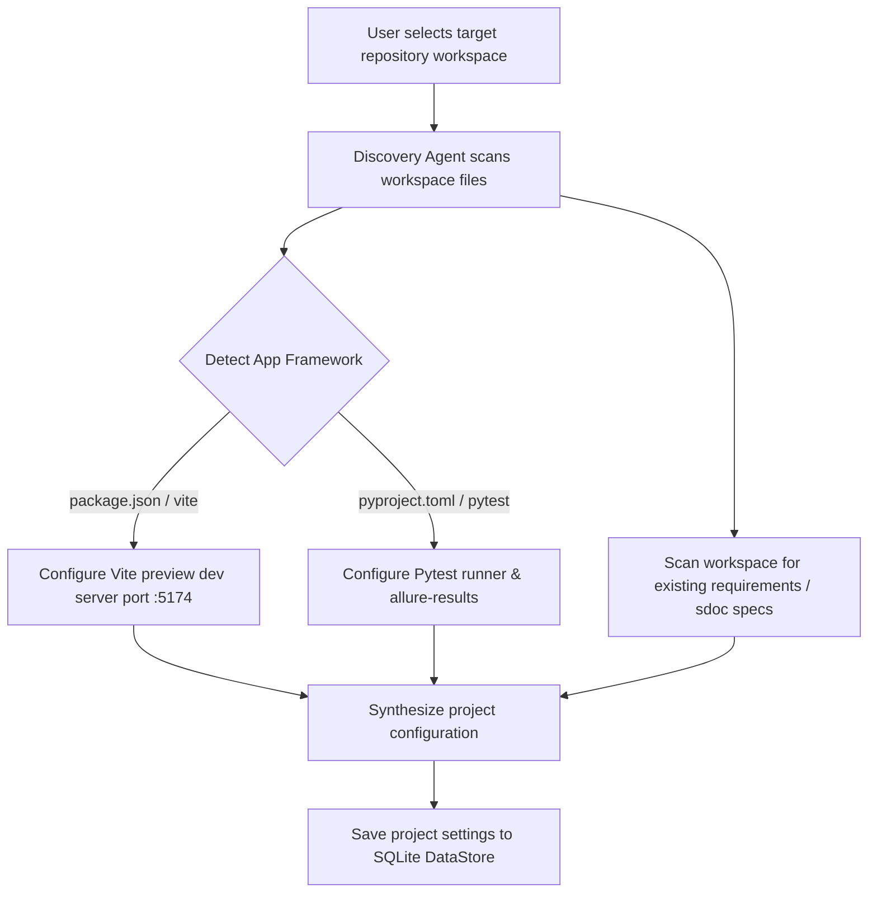

# Onboarding & Workspace Discovery Workflow

When Provable is initialized against a new target repository (or when the active workspace is changed), the discovery subsystem inspects project structure, configuration files, and build manifests to auto-configure agent execution parameters.

## Discovery Steps

### 1. Framework & Dev Server Auto-Detection
- Scans `package.json` for frontend framework markers (Vite, Next.js, React).
- Auto-configures preview server launch commands (e.g. `npm run dev -- --port 5174`).

### 2. Test Runner Discovery
- Checks for `pytest.ini`, `conftest.py`, or `pyproject.toml`.
- Configures default test command: `pytest -v --alluredir=allure-results`.

### 3. Specification Discovery
- Checks for `.sdoc` specification files or `requirements.json`.
- Automatically executes `sync_sdoc_to_db()` to import requirement hierarchies into SQLite.
