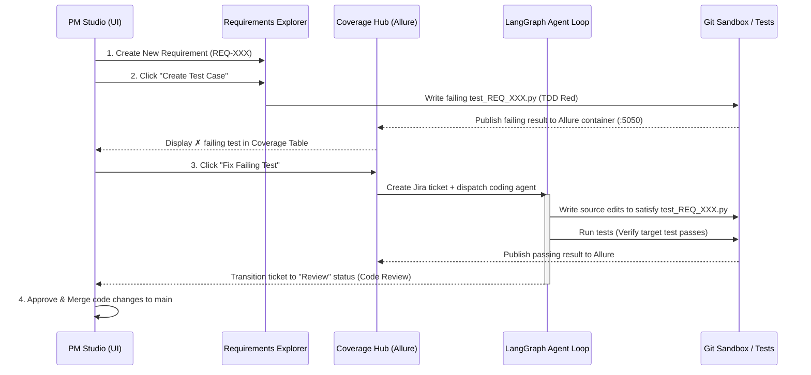

# Shift-Left TDD Workflow

Provable enforces a strict Shift-Left Test-Driven Development (TDD) lifecycle. Instead of writing verification tests after feature implementation, failing pytest test specs are auto-generated before any source code is modified.

## Detailed TDD Lifecycle Steps

### 1. Specification Creation
- A Project Manager creates a requirement, task, or bug in the **Requirements Explorer**.
- The item is created in `Backlog` status with **no linked test cases** (indicated by a white circle icon `○`).

### 2. Failing Test Case Generation (TDD Red)
- The PM clicks **"Create Test Case"** on the requirement detail panel.
- The backend loads `prompts/test_case_generation.md` and calls the LLM to write a BDD-structured pytest file (`workspace/tests/test_<REQ_ID>.py`).
- The generated test includes `@allure.id`, `@allure.title`, and BDD docstrings (`Given`, `When`, `Then`).
- The backend immediately executes the new test file to verify that it **fails**. If it passes unexpectedly, it is discarded and regenerated with stricter assertions.
- This establishes the verified **TDD Red** baseline (represented by a red cross icon `✗`).

### 3. Coverage Matrix & Allure Sync
- The **Coverage Hub** aggregates all requirements and their linked test status.
- Test execution results are uploaded to the containerized Allure Docker Service (`:5050`) and displayed in the embedded iframe.

### 4. Developer Agent Execution (TDD Green)
- The PM clicks **"Fix Failing Test"** next to the failing item.
- The backend dispatches the LangGraph developer agent loop.
- The agent modifies source code files inside `workspace/` until the target pytest spec passes without breaking existing tests.

### 5. Review & Merge Approval
- Upon test pass (TDD Green), the agent submits the branch to `Review` status.
- The PM inspects the git diff in **Code Review** and clicks **Approve**.
- The backend merges `ticket/<TICKET_ID>` into `main` and updates requirement status to `Done`.
