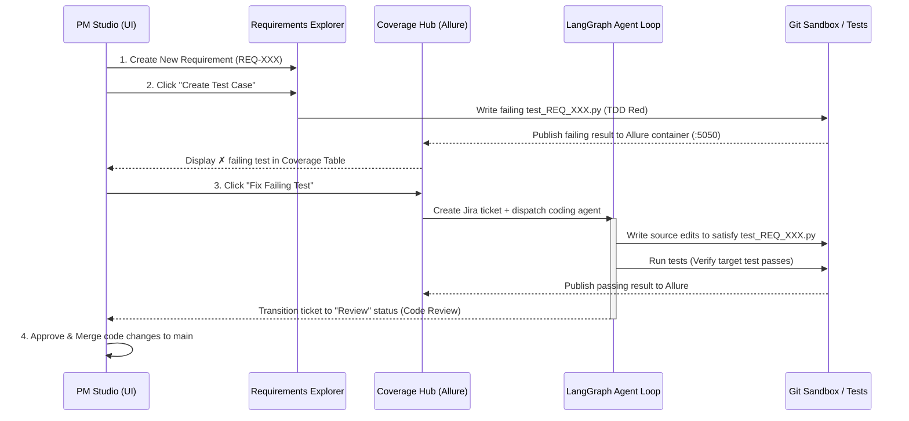

# Shift-Left TDD Workflow

Provable operates on a Shift-Left Test-Driven Development (TDD) workflow. Rather than writing verification suites after approval, developers write or auto-generate failing test cases before implementation begins. The source of development tasks originates from coverage gaps on the Allure Coverage Hub, ensuring complete traceability.

## Core Steps

### 1. Requirement Creation
*   A new specification (or bug report) is created in the **Requirements Explorer**.
*   This requirement starts in `Backlog` status with **no linked test cases** (represented by a white circle icon `○`).

### 2. Failing Test Case Generation (TDD Red)
*   The PM clicks the **"Create Test Case"** button on the requirement detail panel.
*   The backend calls the LLM with `prompts/test_case_generation.md` to write a BDD-structured pytest file (`workspace/tests/test_{req_id}.py`) that exercises the described behavior.
*   The test case is generated with `@allure.id`, `@allure.link`, and BDD docstrings (`Given`, `When`, `Then`).
*   The backend runs the test immediately to verify that it **fails**. If it passes, the test is discarded and regenerated. This establishes the initial TDD "Red" state (represented by a red cross icon `✗`).

### 3. Allure Coverage Matrix
*   The **Coverage Hub** aggregates all requirements and their verification states.
*   Failing tests are automatically compiled by the Allure Docker Service and displayed inside the coverage matrix alongside an embed of the Allure Report portal.

### 4. Ticket Dispatch & Implementation
*   To start implementing code, the PM clicks **"Fix Failing Test"** next to the failing test case inside the Coverage Hub.
*   The backend creates a Jira ticket mapped to the requirement and starts the LangGraph agent loop.
*   The agent's success criterion is clear: modify source code until the specific failing test case passes, without breaking any existing test cases.

### 5. Code Review & Merge
*   Once the test passes, the agent uploads the results to Allure (transitioning the coverage matrix to a green checkmark `✅`) and submits the code to `Review` status.
*   The PM reviews the diff side-by-side with the BDD test docstring and clicks **"Approve"** to merge the changes directly into the `main` branch.
