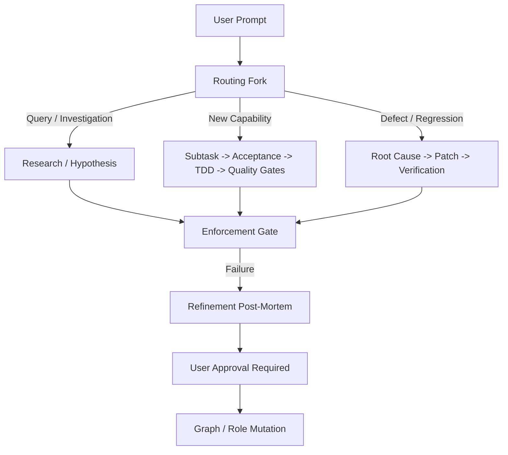

# Concept & Vision: Self-Emergent Role Graph Architecture

## 1. Overview & Core Hypothesis
This document archives the blueprint for the **From-Scratch Emergence Experiment**.

The core hypothesis is that an AI coding system does not need a large set of hand-crafted static rules. Instead, it can start with **zero predefined roles** and evolve a deterministic, stable execution graph/tree through continuous self-critique, mutation, and human gatekeeping.

---

## 2. The Emergence Mechanism (The Manager-Role)

In the pure emergence model:
1. **The Manager Role (Seed Node)**:
   - Starts as the sole active role.
   - Responsible for CRUD operations on `.agents/roles/` and `.agents/roles_graph.json`.
   - When a user prompt arrives, if no suitable role exists, the Manager creates one or decomposes the problem into sub-nodes.
2. **The Refinement Role**:
   - Triggered on any execution failure.
   - Evaluates performance across the role chain.
   - Proposes mutations (adding, removing, splitting, or re-wiring roles) via an `implementation_plan.md` artifact.
   - **Human-in-the-Loop Gate**: No role mutation is applied without explicit user approval.
3. **The Single-Attempt Delivery Invariant**:
   - Each role gets exactly one delivery attempt per invocation.
   - Trial-and-error retry loops are forbidden.
   - If a delivery attempt fails verification, failure is declared immediately to feed clean post-mortem signals into the refinement engine.

---

## 3. Anticipated Emergent Topologies

Through evolutionary pressure, the graph is expected to stabilize into specialized paths based on prompt intent:

---

## 4. Status & Phasing
- **Phase 1 (Active)**: Structured seed topology deployed in `.agents/roles/` to validate individual role contracts, enforcement, and refinement loops.
- **Phase 2 (Future Experiment)**: Wipe `.agents/roles/` down to the bare Manager-Role to observe whether the system independently rediscovers or optimizes these role boundaries.
