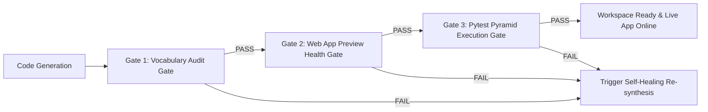

# Automated Verification & Self-Healing Pipeline

The **Automated Verification & Self-Healing Pipeline** enforces strict quality invariants on code synthesized by Provable. Every domain synthesis request executes a multi-gate verification pipeline before marking a workspace build as successful.

---

## 🛡️ Verification Gates Breakdown

### 1. Vocabulary Audit Gate (`audit_domain_vocabulary`)
- **Location**: [`backend/main.py`](file:///c:/Users/ahlst/Documents/GitHub/provable/backend/main.py)
- **Objective**: Prevent template leakage and ensure non-retail domain pitches use 100% native domain vocabulary.
- **Rules**:
  - Scans all synthesized backend and frontend files (`model.py`, `commands.py`, `events.py`, `orm.py`, `App.tsx`).
  - For non-retail pitches, verifies **0 occurrences** of forbidden leftover terms (`_purchased_quantity`, `OrderLine`, `test_allocating_reduces_available_quantity`).
  - If a violation occurs, the build is rejected and re-synthesized using the schema AST.

### 2. Web App Preview Health Gate (`verify_preview_health`)
- **Location**: [`backend/main.py`](file:///c:/Users/ahlst/Documents/GitHub/provable/backend/main.py)
- **Objective**: Guarantee that the frontend React 18 application builds cleanly and renders live in the PM Studio **Live App** tab.
- **Checks**:
  1. **Vite Production Bundle Build**: Executes `npx vite build` in `workspace/` to verify zero JSX, TypeScript, or asset import compilation errors.
  2. **Dev Server Reachability**: Sends an HTTP GET request to `http://localhost:5174/` to ensure the Vite dev server is online and serving valid HTML (`
`).

### 3. Pytest Pyramid Execution Gate (`run_pytest`)
- **Location**: [`backend/agent_orchestrator.py`](file:///c:/Users/ahlst/Documents/GitHub/provable/backend/agent_orchestrator.py)
- **Objective**: Execute Low-Gear (Domain unit tests) and High-Gear (Service layer integration tests) Pytest suites.
- **Allure Reporting**: Automatically publishes test execution results to the containerized Allure reporting service on port `5050`.

---

## 🏰 Clean Workspace Scaffold Invariant

To ensure that resetting projects or initializing workspace services never leaves Vite port `5174` offline or displaying blank 404 pages, `create_default_workspace_scaffold(ws_base)` is automatically invoked on startup and resets:
- Writes a valid default React 18 + Vite template (`package.json`, `vite.config.ts`, `index.html`, `src/App.tsx`).
- Guarantees Vite dev server port 5174 is ALWAYS active.

---

## 🔗 Related Documentation
- [[Universal-Dynamic-Domain-AST-Generator]]
- [[Shift-Left TDD Workflow]]
- [[Testing Strategy]]
- [[Frontend Components]]
