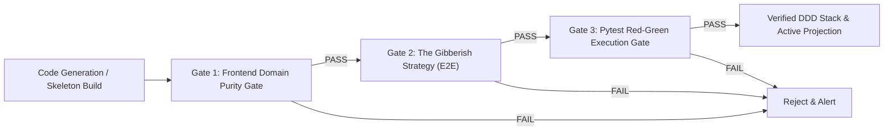

# Automated Verification & Self-Healing Pipeline

The **Automated Verification Pipeline** enforces strict domain purity, schema contract projection, and TDD invariants across Provable.

---

## 🛡️ Verification Gates Breakdown

### 1. Frontend Domain Purity Gate (`test_frontend_domain_purity.py`)
- **Objective**: Ensure the frontend remains 100% domain-agnostic and free of hardcoded domain words (`pizza`, `cart`, `checkout`, `pallet`, `zone`).
- **Mechanism**: Dynamically extracts active backend aggregate roots and attributes via static AST parsing and scans `frontend/src/` to guarantee zero domain term leakage.

### 2. The Gibberish Strategy E2E Gate (`test_ui_dynamic_projection.py`)
- **Objective**: Mathematically prove that the UI is a pure dumb projection of backend schemas.
- **Mechanism**: Feeds the presentation layer a synthetic nonsense schema (`TestFlorg` / `Zorp`) and asserts that the UI dynamically renders `TestFlorg` and `Zorp` without fallback to static mock components.

### 3. Pytest Execution Gate & 5-Line Hash Lock (`tdd_machine.py`)
- **Objective**: Programmatically enforce RED (Exit Code 1 + `AssertionError`), GREEN (Exit Code 0), and anti-tampering SHA-256 test file integrity.

### 4. Gates on the generated frontend (kickstart)
- **Restyle gate** (`backend/onboarding/styling_synthesizer.py`): a restyled component replaces the working one only if it still has the exports other files import and compiles in the workspace (`compile_tsx` in `backend/onboarding/verification.py`, the esbuild that Vite serves the preview with). A refusal is fed back for one more attempt; after a second refusal the component stays as the presentation stage wrote it. Bracket counting and a rule that demanded `export default` are no longer the verdict: the first let a broken type through to the preview, the second refused correct restyles.
- **QA gate** (`backend/onboarding/qa_auditor.py`, `qa_gate.py`): three devices, one rework fed the defects. Horizontal overflow is measured against the emulated device width, never `window.innerWidth` (a mobile browser widens its layout viewport to fit overflowing content, so the two grow together). A crash defect quotes the Vite overlay's message and file, and an overflow defect names the elements that run past the edge. Text that an `overflow-hidden` ancestor cuts off at the screen edge is reported as a warning: it is in the verdict and the run summary, and does not trigger rework.

---

## 🏛️ Discrepancies & Evolution Tags

> [!NOTE]
> [DISCREPANCY: Doc approach better - The original pipeline specified an automated self-healing re-synthesis loop triggered whenever verification gates fail. While tdd_machine.py provides 3-strike repair loops for backend domain classes, an automated end-to-end self-healing orchestrator for the entire stack remains a vital enterprise feature.]

---

## 🔗 Related Documentation
- [[Enterprise-AppGen-TDD-Engine-Architecture]]
- [[Testing Strategy]]
- [[Bug-Reproduction-and-Testing-Policy]]

