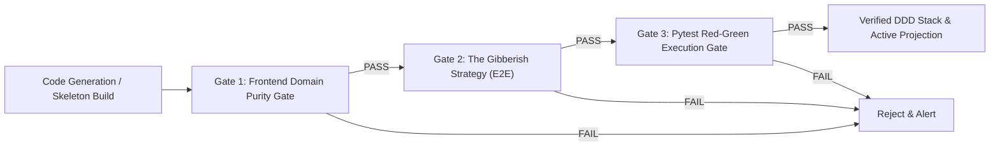

# Automated Verification & Self-Healing Pipeline

The **Automated Verification Pipeline** enforces strict domain purity, schema contract projection, and TDD invariants across Provable.

---

## 🛡️ Verification Gates Breakdown

### 1. Frontend Domain Purity Gate (`test_frontend_domain_purity.py`)
- **Objective**: Ensure the frontend remains 100% domain-agnostic and free of hardcoded domain words (`pizza`, `cart`, `checkout`, `pallet`, `zone`).
- **Mechanism**: Dynamically extracts active backend aggregate roots and attributes via static AST parsing and scans `frontend/src/` to guarantee zero domain term leakage.

### 2. The Gibberish Strategy E2E Gate (`test_ui_dynamic_projection.py`)
- **Objective**: Mathematically prove that the UI is a pure dumb projection of backend schemas.
- **Mechanism**: Feeds the presentation layer a synthetic nonsense schema (`TestFlorg` / `Zorp`) and asserts that the UI dynamically renders `TestFlorg` and `Zorp` without fallback to static mock components.

### 3. Pytest Execution Gate & 5-Line Hash Lock (`tdd_machine.py`)
- **Objective**: Programmatically enforce RED (Exit Code 1 + `AssertionError`), GREEN (Exit Code 0), and anti-tampering SHA-256 test file integrity.

### 4. Gates on the generated frontend (kickstart)
- **Styled once, then looked at once.** The UX plan decides the page's visual direction (palette, type, first screen, shape) and the presentation stage writes the page already styled from it. There is no second rewrite. After QA, the visual review (`backend/onboarding/visual_review.py`) shows a model the whole-page desktop and phone screenshots beside the component sources and asks for the problems a visitor would notice. Each repair is a class change (`ClassEdit`: in this file, this class text becomes that), applied by the pipeline inside class attributes only, so it cannot change copy, structure or logic. A changed file must compile (`compile_tsx` in `backend/onboarding/verification.py`) and the page must pass a fresh QA audit, or the files are put back. One look, no second; what could not be repaired is listed in the run summary.
- **QA gate** (`backend/onboarding/qa_auditor.py`, `qa_gate.py`): three devices audited in parallel browsers, one rework fed the defects. Horizontal overflow is measured against the emulated device width, never `window.innerWidth` (a mobile browser widens its layout viewport to fit overflowing content, so the two grow together). A crash defect quotes the Vite overlay's message and file, and an overflow defect names the elements that run past the edge. Text that an `overflow-hidden` ancestor cuts off at the screen edge is reported as a warning: it is in the verdict and the run summary, and does not trigger rework.
- **Forms are used, not only measured** (`backend/onboarding/qa_form_check.py`): on the desktop device, after the screenshots, each form is filled with values its fields accept (chosen from the field's own type, limits and options, never from its name), submitted, and the API's answer is read. A request the API refuses or that never arrives is a defect quoted with the API's own reason, and goes to the one rework like any other. A form the check cannot complete (a field it cannot satisfy, no submit control, nothing sent) is a warning. A record the check created is deleted again through the generated API's `DELETE /api/<plural>/{id}`.
- **Claims** are part of the visual review's one look: it is shown the seed records beside the sources and reports statements about the business written into the page as fixed text that no record carries, as a list of its own (`claims`) beside the visual problems. It reports them (a class change cannot fix one); the prevention is upstream, in the decomposition and the UX plan ([[Audience Roles and Seed Data]]).

---

## 🏛️ Discrepancies & Evolution Tags

> [!NOTE]
> [DISCREPANCY: Doc approach better - The original pipeline specified an automated self-healing re-synthesis loop triggered whenever verification gates fail. While tdd_machine.py provides 3-strike repair loops for backend domain classes, an automated end-to-end self-healing orchestrator for the entire stack remains a vital enterprise feature.]

---

## 🔗 Related Documentation
- [[Enterprise-AppGen-TDD-Engine-Architecture]]
- [[Testing Strategy]]
- [[Bug-Reproduction-and-Testing-Policy]]

## Actions work before the page is written

The action protocol only names the actions the page offers, and the generated API runs an action by calling the method
of that name on the aggregate. A kickstart that stops there produces a page on which every action answers "Unknown
action". So the kickstart's `action_behaviour` stage (`backend/onboarding/action_behaviour.py`) runs between the action
protocol and the presentation:

- One spec per aggregate states all of its actions (name, parameters, what each changes), and goes through the same
  TDD loop as every later spec: a RED test, GREEN, the regression gate.
- Its test is kept as `tests/unit/test_spec_act_<aggregate>.py`, so later specs are written knowing it and cannot break
  an action unnoticed.
- The code is then compared with the manifest. An action without a method fails the stage by name and the run is
  DEGRADED; nothing is stubbed.
- The page is written afterwards, against the class as it really is (its fields and methods).

The regression gate re-runs `tests/unit` only. The page's browser checks live in `tests/acceptance`: they say nothing
about a domain change and take longer than the gate waits. A regression run that does not finish is not a verdict on
the code: the spec fails with that reason and is not retried.

What this does not prove: that the page calls each action on the right record with the right parameters. The audit
submits forms but does not click through an action's flow.
