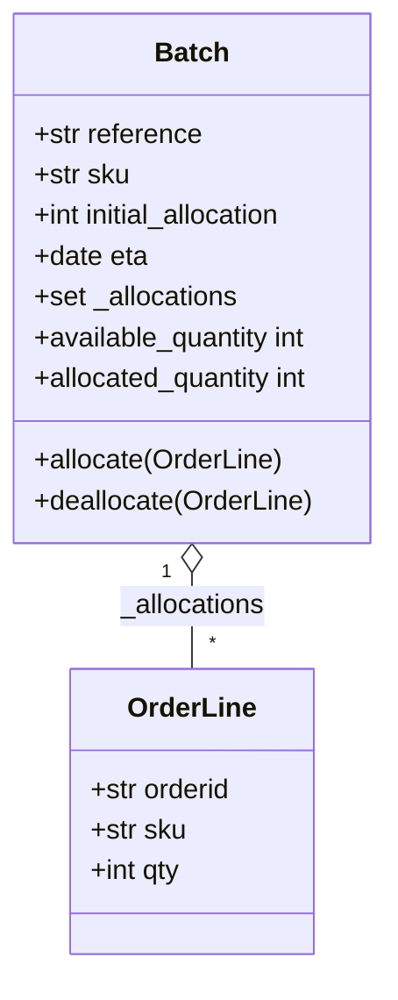

# Chapter 1: Domain Modeling (Cosmic Python Journey)

Welcome to Chapter 1 of our dual-track exploration! Here we examine how to build a pure Python domain model driven by unit tests (Low Gear TDD) and extract universal guidelines for Provable's automated app generation workflow.

---

## 🎯 Track A: Concrete Domain Implementation (Allocation & Inventory)

### Problem Statement
The allocation system must match customer `OrderLine`s to available stock `Batch`es according to business rules:
- **OrderLine**: Represents a request for a specific product SKU and quantity.
- **Batch**: Represents a shipment or stock allotment of a SKU with a fixed initial quantity and optional ETA date.
- **Business Invariant 1**: Allocating an `OrderLine` to a `Batch` reduces the batch's available quantity by `line.qty`.
- **Business Invariant 2**: A batch can only allocate an order line if `batch.sku == line.sku` and `batch.available_quantity >= line.qty`.
- **Business Invariant 3**: Allocation is idempotent (allocating an already allocated line has no additional effect).
- **Business Invariant 4**: Batches with earlier ETAs should be allocated first.



### Pure Python Domain Code (`domain/model.py`)
```python
from dataclasses import dataclass
from datetime import date
from typing import Optional, Set

@dataclass(frozen=True)
class OrderLine:
    """Value Object: Immutable data structure defined purely by its attributes."""
    orderid: str
    sku: str
    qty: int

class Batch:
    """Entity: Object with persistent identity defined by `reference`."""
    def __init__(self, ref: str, sku: str, qty: int, eta: Optional[date] = None):
        self.reference = ref
        self.sku = sku
        self._purchased_quantity = qty
        self.eta = eta
        self._allocations: Set[OrderLine] = set()

    def allocate(self, line: OrderLine) -> None:
        if self.can_allocate(line):
            self._allocations.add(line)

    def deallocate(self, line: OrderLine) -> None:
        if line in self._allocations:
            self._allocations.remove(line)

    @property
    def allocated_quantity(self) -> int:
        return sum(line.qty for line in self._allocations)

    @property
    def available_quantity(self) -> int:
        return self._purchased_quantity - self.allocated_quantity

    def can_allocate(self, line: OrderLine) -> bool:
        return self.sku == line.sku and self.available_quantity >= line.qty

    def __eq__(self, other) -> bool:
        if not isinstance(other, Batch):
            return False
        return other.reference == self.reference

    def __hash__(self) -> int:
        return hash(self.reference)

    def __gt__(self, other: "Batch") -> bool:
        if self.eta is None:
            return False
        if other.eta is None:
            return True
        return self.eta > other.eta
```

### Low Gear TDD Unit Tests (`tests/unit/test_batches.py`)
```python
from datetime import date
import pytest
from domain.model import Batch, OrderLine

def test_allocating_to_a_batch_reduces_the_available_quantity():
    batch = Batch("batch-001", "SMALL-TABLE", qty=20, eta=date.today())
    line = OrderLine("order-ref", "SMALL-TABLE", 2)
    batch.allocate(line)
    assert batch.available_quantity == 18

def test_can_allocate_if_available_greater_than_required():
    large_batch, small_line = make_batch_and_line("ELEGANT-LAMP", 20, 2)
    assert large_batch.can_allocate(small_line)

def test_cannot_allocate_if_available_smaller_than_required():
    small_batch, large_line = make_batch_and_line("ELEGANT-LAMP", 2, 20)
    assert small_batch.can_allocate(large_line) is False

def test_cannot_allocate_if_skus_do_not_match():
    batch = Batch("batch-001", "UNCOMFY-CHAIR", 100)
    line = OrderLine("order-123", "EXPENSIVE-FOOTSTOOL", 10)
    assert batch.can_allocate(line) is False

def test_allocation_is_idempotent():
    batch, line = make_batch_and_line("ANGEL-STATUE", 20, 2)
    batch.allocate(line)
    batch.allocate(line)
    assert batch.available_quantity == 18

def make_batch_and_line(sku: str, batch_qty: int, line_qty: int):
    return Batch("batch-001", sku, batch_qty, eta=date.today()), OrderLine("order-123", sku, line_qty)
```

---

## 🌐 Track B: Universal Agent Workflow Guidelines (Extracted Rules)

Based on Chapter 1, we extract 4 universal guidelines that Provable will use when instructing developer agents to build domain logic for *any* application:

### Guideline 1: Pure Domain Isolation ("No Framework Leaks")
> **Rule**: Domain models must be written in pure Python standard library types (`dataclass`, `typing`, `enum`, `datetime`).
> **Enforcement**: Developer agents are prohibited from importing ORM decorators (`@declarative_mixin`, `Column`, `relationship`), web decorators (`@app.get`), or IO modules inside `domain/`.

### Guideline 2: Explicit Identity Distinction (Value Objects vs Entities)
> **Rule**: Agents must distinguish between immutable Value Objects and stateful Entities:
> - **Value Objects**: Use `@dataclass(frozen=True)` with equality based on values (e.g. `Money`, `Address`, `OrderLine`).
> - **Entities**: Use standard classes with identity defined strictly by a unique reference/ID (`__eq__` and `__hash__` based solely on `id`).

### Guideline 3: Low Gear TDD First ("Test Invariants, Not Frameworks")
> **Rule**: When building a new feature domain:
> 1. Agent must first write unit tests that verify domain invariants directly on domain objects (zero database, zero HTTP mocks).
> 2. Domain tests must execute in < 0.1s.

### Guideline 4: Encapsulate State Transitions Inside Domain Methods
> **Rule**: External callers (service layers or APIs) must NEVER mutate an entity's internal collections or private variables directly (e.g., `batch._allocations.add(line)` is forbidden). All state changes must occur through explicit domain methods (e.g. `batch.allocate(line)`).

---

*Documented in Obsidian Vault under `vault/06-Cosmic-Python-Journey/Chapter-01-Domain-Model.md`.*
