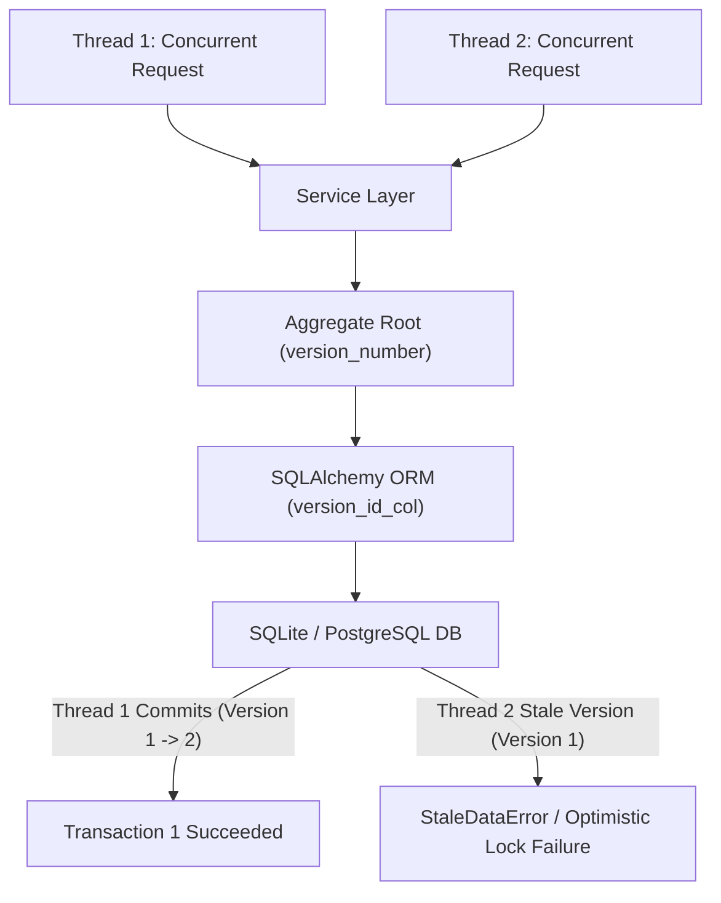

# Chapter 7: Aggregates & Optimistic Concurrency Controls

Chapter 7 of *Architecture Patterns with Python* introduces **Aggregates** (consistency boundaries) and **DB-Enforced Optimistic Concurrency Controls**.



---

## 🏛️ Architectural Implementation

In Provable, all synthesized domain models enforce Aggregate consistency boundaries and DB-enforced optimistic concurrency:

### 1. Aggregate Root `version_number` Tracking
Every Aggregate Root class (`Product`, `PizzaOrder`, `Appointment`) includes an explicit `version_number` attribute initialized to `0` or loaded from persistence:

```python
class PizzaOrder:
    def __init__(self, order_number: str, customer_name: str, items: List[OrderItem], version_number: int = 0):
        self.order_number = order_number
        self.customer_name = customer_name
        self.items = items
        self.version_number = version_number
        self.events: List[events.Event] = []

    def start_baking(self, oven_id: str) -> None:
        self.status = OrderStatus.BAKING
        self.version_number += 1  # Increment version on aggregate mutation
```

### 2. SQLAlchemy ORM `version_id_col` Mapping
In `src/adapters/orm.py`, the SQLAlchemy imperative mapper links `version_id_col` directly to the aggregate's database column:

```python
pizza_orders = Table(
    "pizza_orders",
    metadata,
    Column("order_number", String(255), primary_key=True),
    Column("customer_name", String(255), nullable=False),
    Column("version_number", Integer, nullable=False, server_default="0"),
)

def start_mappers():
    mapper_registry.map_imperatively(
        PizzaOrder,
        pizza_orders,
        version_id_col=pizza_orders.c.version_number
    )
```

### 3. Concurrency Protection Invariant
If two concurrent worker threads attempt to modify the same Aggregate Root simultaneously, SQLAlchemy emits `sqlalchemy.orm.exc.StaleDataError`, rolling back the stale transaction and preserving data consistency.

---

## 🔗 Related Documentation
- [[05-DDD-TDD-Architecture-Guidelines]]
- [[Universal-Dynamic-Domain-AST-Generator]]
- [[Chapter-01-Domain-Model]]
