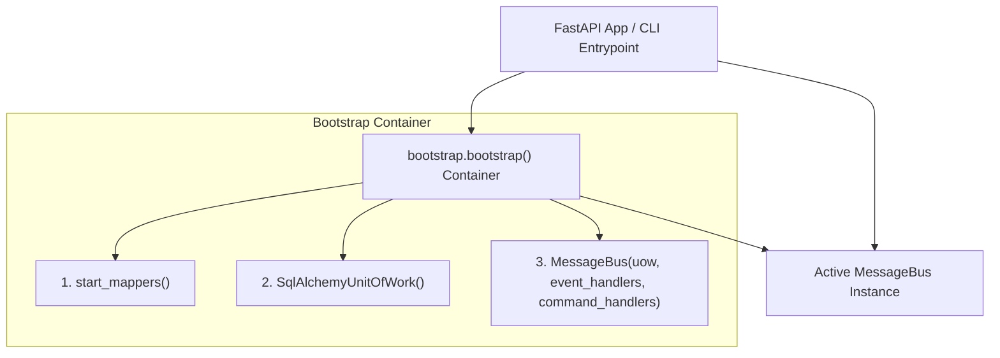

# Chapter 13: Dependency Injection & Bootstrap Container

Chapter 13 of *Architecture Patterns with Python* introduces the **Bootstrap Container** pattern to decouple initialization logic and dependencies from application entrypoints.



---

## 🏛️ Architectural Implementation

In Provable, all synthesized application stacks expose a `bootstrap.py` module ([`src/bootstrap.py`](file:///c:/Users/ahlst/Documents/GitHub/provable/workspace/src/bootstrap.py)) that wires application dependencies:

```python
import inspect
from typing import Callable, Dict, Type
from src.adapters import orm
from src.domain import commands, events
from src.service_layer import messagebus, unit_of_work

def bootstrap(
    start_orm: bool = True,
    uow: unit_of_work.AbstractUnitOfWork = None,
    publish: Callable = None,
) -> messagebus.MessageBus:
    """Dependency Injection Container and MessageBus Initializer."""
    if start_orm:
        orm.start_mappers()

    if uow is None:
        uow = unit_of_work.SqlAlchemyUnitOfWork()

    if publish is None:
        publish = lambda event: print(f"📡 EVENT PUBLISHED: {event}")

    # Inject dependencies dynamically using inspect.signature
    injected_command_handlers = {
        # Command handlers wired to UoW and publish dependencies
    }

    return messagebus.MessageBus(
        uow=uow,
        event_handlers={},
        command_handlers=injected_command_handlers
    )
```

---

## 🔑 Key Benefits
1. **Testing Flexibility**: Tests can invoke `bootstrap(start_orm=False, uow=FakeUnitOfWork())` to inject fake repositories and test doubles without touching SQLite databases.
2. **Decoupled Entrypoints**: FastAPI API routes (`src/entrypoints/app.py`) do not manage ORM initialization or session factories; they simply call `bus.handle(command)`.

---

## 🔗 Related Documentation
- [[05-DDD-TDD-Architecture-Guidelines]]
- [[Universal-Dynamic-Domain-AST-Generator]]
- [[Chapter-07-Aggregates-and-Optimistic-Concurrency]]
