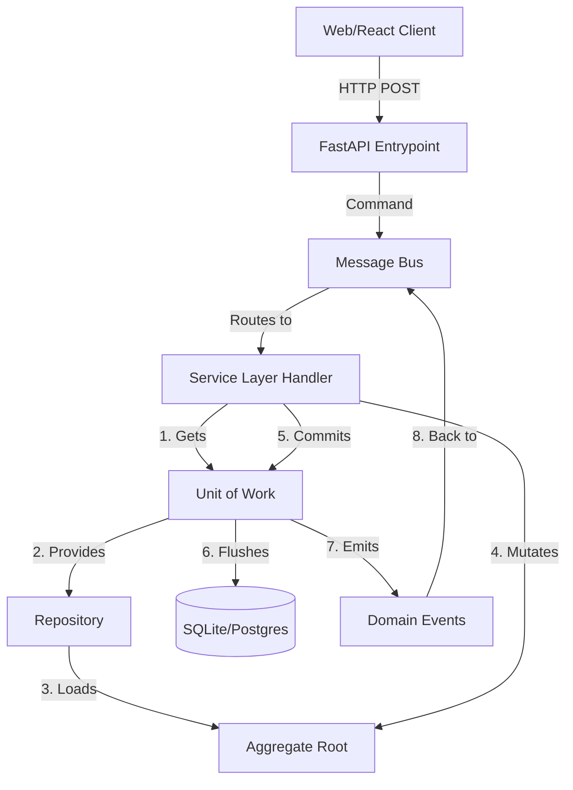

# Architectural Law: Patterns with Python

This document serves as the **authoritative architectural reference** for AI agents and human developers working on this project. It condenses the principles of *Architecture Patterns with Python* into actionable, stack-aware guidelines. The core stack includes **Python, FastAPI, SQLAlchemy, SQLite, and React**.

This guide is designed to be self-contained, detailed, and directly applicable. It dictates how to organize code, manage state, and build scalable event-driven systems.

---

## Part 0: Philosophy & Mindset

### Why Designs Go Wrong (The Big Ball of Mud)
Software systems naturally tend toward chaos. Without deliberate architectural effort, a well-ordered codebase collapses into a "Big Ball of Mud"—a state characterized by high coupling, low cohesion, and a sameness of function where everything depends on everything else. In such systems, a small change in one place causes unpredictable side effects in completely unrelated areas, destroying development velocity.

### Encapsulation, Abstractions, Layering
Encapsulation is about simplifying behavior and hiding data. By identifying a task and assigning it to a well-defined object or function (an abstraction), we protect the rest of the system from its internal complexities. Abstracting away details helps make code expressive, testable, and easier to maintain. 
Layering ensures that different concerns are separated. The business rules should live in a pure layer, isolated from the messy details of web frameworks and databases.

### The Dependency Inversion Principle (DIP)
The Dependency Inversion Principle is a core tenet of our architecture:
1. High-level modules (business rules) should not depend on low-level modules (infrastructure, databases). Both should depend on abstractions.
2. Abstractions should not depend on details. Details should depend on abstractions.

We insert abstractions between the high-level domain model and the low-level infrastructure (like SQLAlchemy) so they can evolve independently.

### TDD as a Design Practice
Test-Driven Development (TDD) is not just about testing; it is fundamentally a **design practice**. Writing the test first forces you to think about the interface and the behavior from the client's perspective before getting bogged down in the implementation details. 

### Fakes over Mocks Philosophy
Our testing philosophy strongly prefers **Fakes over Mocks**:
- **Mocks (London-school):** Verify *how* something is used. This tightly couples tests to implementation details, making refactoring a nightmare.
- **Fakes (Classic-school):** Working implementations designed for tests (e.g., an in-memory `FakeRepository`). They allow assertions about the end state of a system, keeping tests robust and decoupling them from internal mechanics.

### High Gear vs Low Gear TDD
- **High Gear:** Testing at the boundaries (e.g., Service Layer or API). This provides maximum coverage and safety for refactoring the underlying domain model.
- **Low Gear:** Testing individual domain objects (Entities, Value Objects). Use this when the logic is particularly complex and needs targeted verification. Most tests should be high gear.

---

## Part I: Building Architecture to Support Domain Modeling

### Domain Model (Entities, Value Objects, Domain Services, Domain Exceptions)

#### What it is
The Domain Model is the mental map of the business. It contains Entities, Value Objects, Domain Services, and Domain Exceptions. 
- **Value Object**: Uniquely identified by its data (e.g., `Money(amount, currency)`). Immutable.
- **Entity**: Has a long-lived identity (e.g., `User(id)`). Attributes may change, but it's the same entity.
- **Domain Service**: Stateless functions for operations that don't fit inside a single entity.
- **Domain Exception**: Custom exceptions expressing business rules (e.g., `OutOfStock`).

#### Why it matters
It isolates business logic from infrastructure, ensuring that the most valuable part of the codebase is purely focused on solving business problems without being polluted by database ORMs or HTTP routing.

#### Code Example
```python
from dataclasses import dataclass
from typing import List, Optional

class OutOfStock(Exception):
    pass

@dataclass(frozen=True)
class OrderLine:
    orderid: str
    sku: str
    qty: int

class Batch:
    def __init__(self, ref: str, sku: str, qty: int):
        self.reference = ref
        self.sku = sku
        self._purchased_quantity = qty
        self._allocations = set()  # type: set[OrderLine]

    def allocate(self, line: OrderLine):
        if self.can_allocate(line):
            self._allocations.add(line)

    def deallocate(self, line: OrderLine):
        if line in self._allocations:
            self._allocations.remove(line)

    @property
    def allocated_quantity(self) -> int:
        return sum(line.qty for line in self._allocations)

    @property
    def available_quantity(self) -> int:
        return self._purchased_quantity - self.allocated_quantity

    def can_allocate(self, line: OrderLine) -> bool:
        return self.sku == line.sku and self.available_quantity >= line.qty
```

#### Trade-offs Table
| Pros | Cons |
| --- | --- |
| Highly testable without databases. | Requires translating domain models to persistence models. |
| Pure representation of business rules. | Can feel overly complex for simple CRUD applications. |

#### Key Rules/Invariants
- No dependencies on ORMs (SQLAlchemy), web frameworks (FastAPI), or external APIs.
- Must be fully testable with pure unit tests (no mocking required).

---

### Repository Pattern

#### What it is
The Repository pattern is an abstraction over persistent storage. It provides an illusion of an in-memory collection of objects. Instead of the domain model inheriting from SQLAlchemy's `Base`, the ORM depends on the domain model via classical mappers or explicit translation functions.

#### Why it matters
It decouples the domain from the database. It allows us to easily swap out a real database for a `FakeRepository` in tests, drastically speeding up the test suite and preventing tests from touching the filesystem or network.

#### Code Example
```python
import abc
from typing import Set
# Domain model imports
from domain import model

class AbstractRepository(abc.ABC):
    @abc.abstractmethod
    def add(self, batch: model.Batch):
        raise NotImplementedError

    @abc.abstractmethod
    def get(self, reference: str) -> model.Batch:
        raise NotImplementedError

class SqlAlchemyRepository(AbstractRepository):
    def __init__(self, session):
        self.session = session

    def add(self, batch: model.Batch):
        self.session.add(batch)

    def get(self, reference: str) -> model.Batch:
        return self.session.query(model.Batch).filter_by(reference=reference).first()

class FakeRepository(AbstractRepository):
    def __init__(self, batches):
        self._batches = set(batches)

    def add(self, batch: model.Batch):
        self._batches.add(batch)

    def get(self, reference: str) -> model.Batch:
        return next((b for b in self._batches if b.reference == reference), None)
```

#### Trade-offs Table
| Pros | Cons |
| --- | --- |
| Simple interface between storage and domain model. | Maintaining ORM mappings or translation requires extra work. |
| Easy to make a `FakeRepository` for blazingly fast unit testing. | Extra indirection can frustrate those used to Active Record. |

#### Key Rules/Invariants
- Repositories must only return and accept domain objects, never ORM-specific models or rows.
- Repositories do not call `commit()`; that is the responsibility of the Unit of Work.

---

### Service Layer & Unit of Work

#### What it is
The Service Layer (or Use Case layer) orchestrates workflows: fetching data via Repositories, invoking domain logic, and saving changes. 
The Unit of Work (UoW) abstracts atomic operations, acting as a single entrypoint to repositories and ensuring that all changes are committed together or rolled back.

#### Why it matters
The Service Layer keeps domain logic pure by handling infrastructure coordination. The UoW ensures consistency, protecting the system from partial updates and corrupt states.

#### Code Example
```python
import abc
from sqlalchemy.orm import sessionmaker

class AbstractUnitOfWork(abc.ABC):
    batches: AbstractRepository

    def __enter__(self):
        return self

    def __exit__(self, *args):
        self.rollback()

    @abc.abstractmethod
    def commit(self):
        raise NotImplementedError

    @abc.abstractmethod
    def rollback(self):
        raise NotImplementedError

class SqlAlchemyUnitOfWork(AbstractUnitOfWork):
    def __init__(self, session_factory=DEFAULT_SESSION_FACTORY):
        self.session_factory = session_factory

    def __enter__(self):
        self.session = self.session_factory()
        self.batches = SqlAlchemyRepository(self.session)
        return super().__enter__()

    def __exit__(self, *args):
        super().__exit__(*args)
        self.session.close()

    def commit(self):
        self.session.commit()

    def rollback(self):
        self.session.rollback()

# Service Layer function
def allocate(line: model.OrderLine, uow: AbstractUnitOfWork) -> str:
    with uow:
        batch = uow.batches.get(line.sku)
        if batch is None:
            raise model.InvalidSku(f'Invalid sku {line.sku}')
        batch.allocate(line)
        uow.commit()
        return batch.reference
```

#### Trade-offs Table
| Pros | Cons |
| --- | --- |
| UoW makes transaction boundaries explicit. | Reinvents the wheel slightly if using an ORM that has its own UoW. |
| Service Layer explicitly documents application use cases. | Adds layers of boilerplate for simple apps. |

#### Key Rules/Invariants
- All state-altering operations must be wrapped in a UoW context manager.
- Endpoints (FastAPI) should only call Service Layer functions, never Repositories directly.

---

### Aggregates & Consistency Boundaries

#### What it is
An Aggregate is a cluster of associated objects treated as a unit for data changes. It acts as a consistency boundary, ensuring that all invariants are satisfied when state changes.

#### Why it matters
It resolves the tension between protecting invariants and allowing concurrency. Modifying multiple objects in complex graphs causes database lock contention. An Aggregate ensures you only ever modify a single root object per transaction.

#### Code Example
```python
class Product:
    # Product is the Aggregate Root. Batches cannot be modified directly.
    def __init__(self, sku: str, batches: List[Batch], version_number: int = 0):
        self.sku = sku
        self.batches = batches
        self.version_number = version_number
        self.events = [] # type: List[Event]

    def allocate(self, line: OrderLine) -> str:
        try:
            batch = next(b for b in sorted(self.batches) if b.can_allocate(line))
            batch.allocate(line)
            self.version_number += 1
            return batch.reference
        except StopIteration:
            self.events.append(OutOfStock(line.sku))
            return None
```

#### Trade-offs Table
| Pros | Cons |
| --- | --- |
| Defines explicit consistency boundaries, avoiding ORM performance problems. | Forces a rigid rule of "one aggregate per transaction." |
| Makes the system much easier to reason about. | Managing eventual consistency between aggregates is hard. |

#### Key Rules/Invariants
- Repositories should only return Aggregate Roots.
- A single transaction (UoW) must only update a single Aggregate.

---

## Part II: Event-Driven Architecture

### Domain Events & Message Bus

#### What it is
Domain Events are facts about things that happened (e.g., `OutOfStock`). 
The Message Bus is a publish-subscribe system that routes events to appropriate handlers.

#### Why it matters
It enables decoupling. Primary use cases can happen quickly, while side effects (like sending emails or updating read models) happen asynchronously or in separate, decoupled handlers.

#### Code Example
```python
from dataclasses import dataclass
from typing import List, Callable, Dict, Type

class Event:
    pass

@dataclass
class OutOfStock(Event):
    sku: str

def send_out_of_stock_notification(event: OutOfStock):
    print(f"Notification: Out of stock for {event.sku}")

HANDLERS: Dict[Type[Event], List[Callable]] = {
    OutOfStock: [send_out_of_stock_notification],
}

def handle(event: Event):
    for handler in HANDLERS.get(type(event), []):
        handler(event)
```

#### Trade-offs Table
| Pros | Cons |
| --- | --- |
| Decouples primary logic from secondary side effects. | Control flow is implicit and harder to trace. |
| Perfectly models real-world business processes. | Requires disciplined logging to debug. |

#### Key Rules/Invariants
- Events must be named in the past tense (e.g., `OrderAllocated`).
- The Unit of Work should collect events from aggregates and dispatch them via the Message Bus.

---

### Commands vs Events

#### What it is
- **Commands:** Capture intent. Imperative verbs (e.g., `AllocateStock`). Directed to a single handler. Must fail noisily if unsuccessful.
- **Events:** Capture facts. Past tense (e.g., `StockAllocated`). Broadcast to many handlers. Sender doesn't care if a handler fails.

#### Why it matters
Differentiating them allows us to isolate failures. A Command modifies state and must succeed. An Event triggers side effects, which can fail independently without rolling back the primary Command.

#### Code Example
```python
class Command:
    pass

@dataclass
class Allocate(Command):
    orderid: str
    sku: str
    qty: int

Message = Command | Event

def handle(message: Message, uow: AbstractUnitOfWork):
    queue = [message]
    while queue:
        msg = queue.pop(0)
        if isinstance(msg, Event):
            for handler in EVENT_HANDLERS[type(msg)]:
                try:
                    handler(msg, uow=uow)
                    queue.extend(uow.collect_new_events())
                except Exception:
                    continue # Events fail independently
        elif isinstance(msg, Command):
            handler = COMMAND_HANDLERS[type(msg)]
            handler(msg, uow=uow) # Commands fail noisily
            queue.extend(uow.collect_new_events())
```

#### Trade-offs Table
| Pros | Cons |
| --- | --- |
| Clear understanding of what must succeed vs what can be retried. | The semantic difference can be subtle, leading to debate. |

#### Key Rules/Invariants
- Commands must be handled by exactly ONE handler.
- Events can be handled by ZERO OR MORE handlers.

---

### CQRS (Command-Query Responsibility Segregation)

#### What it is
CQRS dictates that Reads (Queries) and Writes (Commands) are fundamentally different operations and should have different models. Commands use the complex Domain Model and Repositories. Queries can bypass the domain entirely and use raw SQL or specialized view models.

#### Why it matters
Writes require strict consistency and business rules (Aggregates). Reads require high performance, cacheability, and often complex joins. Forcing both through the same ORM models leads to performance bottlenecks and compromised designs.

#### Code Example
```python
# A read-only query bypassing the domain model
def get_allocations(orderid: str, uow: SqlAlchemyUnitOfWork):
    with uow:
        # Use raw SQL or lightweight ORM queries for performance
        result = uow.session.execute(
            'SELECT sku, batchref FROM allocations_view WHERE orderid = :orderid',
            {'orderid': orderid}
        )
        return [dict(r) for r in result]
```

#### Trade-offs Table
| Pros | Cons |
| --- | --- |
| Massive performance improvements for reads. | Data in read models may be eventually consistent (stale). |
| Simplifies the write domain model by removing read-specific quirks. | Requires managing separate read models/tables. |

#### Key Rules/Invariants
- Queries must never modify state.
- Commands must not return data (other than maybe an identifier or success status).

---

## Part III: Infrastructure & Bootstrapping

### Dependency Injection (Composition Root)

#### What it is
The Composition Root is a bootstrap script executed at application startup. It wires up dependencies (like Repositories and UoW) and injects them into the Message Bus or Service Layer.

#### Why it matters
It concentrates all knowledge of infrastructure into one place. This makes it trivial to swap out a SQL database for an in-memory dictionary during testing, without touching the application code.

#### Code Example
```python
import inspect

def inject_dependencies(handler, dependencies):
    params = inspect.signature(handler).parameters
    deps = {
        name: dependency
        for name, dependency in dependencies.items()
        if name in params
    }
    return lambda message: handler(message, **deps)

def bootstrap(
    uow: AbstractUnitOfWork = None,
    notifications: AbstractNotifications = None,
    publish: Callable = None,
) -> MessageBus:
    if uow is None:
        uow = SqlAlchemyUnitOfWork()
    
    dependencies = {'uow': uow, 'notifications': notifications, 'publish': publish}
    
    injected_event_handlers = {
        event_type: [inject_dependencies(handler, dependencies) for handler in event_handlers]
        for event_type, event_handlers in EVENT_HANDLERS.items()
    }
    # ... wire up command handlers similarly
    return MessageBus(injected_event_handlers, injected_command_handlers)
```

#### Trade-offs Table
| Pros | Cons |
| --- | --- |
| Centralizes configuration. | Boilerplate setup required. |
| Pure functions/classes without framework magic. | |

#### Key Rules/Invariants
- Never instantiate infrastructure dependencies (like DB sessions) deep inside business logic.
- Always inject dependencies from the outside.

---

### Project Structure Template

```text
├── src
│   ├── myapp
│   │   ├── adapters      # Repositories, ORM mappers, External API clients
│   │   ├── domain        # Entities, Value Objects, Domain Exceptions
│   │   ├── entrypoints   # FastAPI routers, CLI commands, Event consumers
│   │   └── service_layer # Use cases, UoW, Message Bus, Handlers
└── tests
    ├── e2e             # Tests targeting FastAPI endpoints
    ├── integration     # Tests targeting Repositories/DB
    └── unit            # Tests targeting Service Layer with Fakes
```

---

### Validation (Syntactic, Semantic, Pragmatic)

1. **Syntactic:** Is the data well-formed? (e.g., "quantity is an integer"). Validate at the **entrypoints** (e.g., using Pydantic in FastAPI). Be a tolerant reader.
2. **Semantic:** Does the data make sense? (e.g., "SKU exists in the system"). Validate in the **Service Layer** before executing commands.
3. **Pragmatic:** Business rules in context (e.g., "Do we have enough stock?"). Validate inside the **Domain Model**.

---

## Part IV: Practical Guidance

### Getting There from Legacy Code (Strangler Fig)
To migrate a Big Ball of Mud:
1. Carve out a Service Layer for specific use cases.
2. Stop ORM leakage by introducing Repositories.
3. For moving to Microservices, use the **Strangler Fig Pattern**: intercept events from the legacy system, build the new system to consume those events, and gradually strangle the old system.

### Identifying Aggregates
Highly connected object graphs kill performance. Break direct object references (e.g., `user.workspaces[0].docs`) and replace them with IDs (e.g., `Workspace(owner_id=user.id)`). An aggregate represents a true transactional consistency boundary.

### Footguns and Pitfalls
- **Reliable messaging is hard:** Redis pub/sub drops messages. Use reliable brokers (Kafka, RabbitMQ) for external events, or use the Outbox Pattern.
- **Eventual Consistency:** UI/React clients must be designed to handle eventual consistency (e.g., optimistic UI updates or polling/WebSockets) because read models may lag behind writes.
- **Idempotency:** All event handlers must be idempotent. Processing the same event twice must not corrupt state.

### The Complete Pattern Architecture Diagram



This guide encapsulates the rules for maintaining a robust, scalable, and decoupled architecture. Follow these patterns rigorously.
